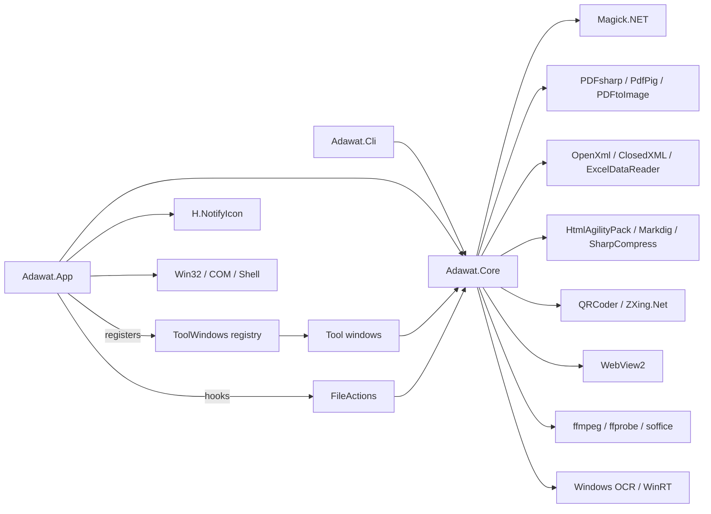

# تحليل شامل لمشروع «أدوات» (Adawat) — تطبيق Windows

> **نوع الوثيقة:** تحليل معماري ووثيقة مرجعية للكود المصدري  
> **النطاق:** المستودع الحالي كما هو في هذه النسخة (تنفيذ Windows فقط)  
> **المسار الذي تم تحليله:** `windows/` مع ملفات الجذر  
> **تاريخ التحليل:** 14 نوفمبر 2026  
> **ملاحظة:** حُدِّثت الوثيقة بعد تنظيف المستودع ليصبح Windows فقط؛ أُزيلت فروع المنصات الأخرى من الكود والتوثيق والبناء.

---

## 1. نظرة عامة

**Adawat (أدوات)** تطبيق سطح مكتب لنظام Windows يعمل في منطقة الإشعارات (Tray)، ووظيفته الأساسية أن يمنح المستخدم «عجلة أوامر» تظهر **أثناء سحب الملفات**، ثم يحوّل أو يضغط أو يعدّل الملفات المسحوبة محليًا بالكامل.

الفكرة العملية:

1. يسحب المستخدم ملفًا أو أكثر من مستكشف الملفات أو سطح المكتب أو أي تطبيق آخر.
2. أثناء السحب يضغط مفتاحًا معدِّلًا (Shift أو Ctrl أو Alt افتراضيًا).
3. تظهر عجلة دائرية عند مؤشر الفأرة تحتوي الخيارات المناسبة لنوع الملفات.
4. يُفلت الملف على الخيار المطلوب، فتُنفَّذ العملية وتظهر النتيجة في إشعار (HUD)، ويمكن فتحها في نافذة Float.

### أهم خصائص المشروع

- **يعمل دون اتصال بالشبكة:** لا يوجد أي اتصال HTTP أو خدمة سحابية أو حساب مستخدم.
- **لا يرفع صلاحيات:** يعمل بمستوى `asInvoker` كالمستخدم الحالي.
- **لا يعدّل الملفات الأصلية:** كل النتائج تُكتب في ملفات جديدة بأسماء فريدة.
- **واجهة عربية وإنجليزية كاملة** مع دعم RTL، تُختار تلقائيًا حسب لغة النظام أو لغة المثبّت.
- **معالجة محلية للملفات:** صور، فيديو، صوت، PDF، مستندات، جداول، عروض تقديمية، ترجمات، وأرشيفات.
- **أدوات سريعة إضافية:** لقطة شاشة، OCR للنص العربي، إدارة حافظة، مفكرة، مشغّل سريع، إصلاح تخطيط لوحة المفاتيح، QR، بلوتوث.

### نطاق النسخة الحالية

المستودع الحالي يحتوي على تنفيذ **Windows فقط** داخل `windows/`. أُزيلت مجلدات macOS وLinux وAndroid
وكل مسارات البناء الخاصة بها، وحُذفت فروع `#if WINDOWS/#else` والنسخ البديلة من الكود المشترك، وأصبحت
سكربتات البناء PowerShell فقط. لذلك يغطي هذا التحليل:

- `windows/src/Adawat.Core`
- `windows/src/Adawat.App`
- `windows/src/Adawat.Cli`
- ملفات البناء والتثبيت والأدوات المساعدة داخل `windows/`

### إحصاءات سريعة

| المقياس | القيمة |
|---|---|
| عدد مشاريع الحل | 3 |
| ملفات C# داخل `windows/src` | 82 ملفًا |
| إجمالي أسطر C# | نحو 15,812 سطرًا |
| `Adawat.Core` | 39 ملفًا / نحو 5,792 سطرًا |
| `Adawat.App` | 42 ملفًا / نحو 9,920 سطرًا |
| `Adawat.Cli` | ملف واحد / نحو 100 سطر |
| ملفات XAML | لا يوجد (كل الواجهات مبنية برمجيًا بـ C#) |
| قاعدة بيانات | لا يوجد |
| واجهات HTTP API | لا يوجد |
| مشاريع اختبارات | لا يوجد |

---

## 2. المعمارية العامة

### 2.1 نمط المعمارية

المشروع يتبع معمارية **تطبيق سطح مكتب أحادي العملية (Single-Process Desktop App)** مقسّمة إلى ثلاث طبقات رئيسية:

```text
┌──────────────────────────────────────────────────────────────┐
│  Adawat.App  (WPF / WinExe / AssemblyName = Adawat)          │
│  Tray + DragMonitor + Wheel + HUD + Floats + Tool Windows    │
└───────────────────────────────┬──────────────────────────────┘
                                │ ProjectReference
┌───────────────────────────────▼──────────────────────────────┐
│  Adawat.Core  (net10.0-windows / UseWPF=true)                │
│  Catalog + Operations + Settings + Output + L10n + Platform  │
└───────────────────────────────▲──────────────────────────────┘
                                │ ProjectReference
┌───────────────────────────────┴──────────────────────────────┐
│  Adawat.Cli  (Exe / AssemblyName = adawat-cli)               │
│  list / run / doctor + --lang                                │
└──────────────────────────────────────────────────────────────┘
```

- **`Adawat.Core`**: كل منطق التحويل والأدوات، ونموذج التشغيل (`AdawatOperation`)، والإعدادات، والتعريب، وطبقة النظام. لا يحتوي على نوافذ تطبيق، لكنه يعتمد على WPF في بعض المساعدات (رسم QR، RTF، طباعة HTML إلى PDF)، ولذلك فعّل `UseWPF`.
- **`Adawat.App`**: تطبيق WPF الفعلي. يملك دورة حياة التطبيق، أيقونة الصينية، مراقبة السحب، العجلة، النوافذ، الأصوات، الإشعارات، وكل واجهات الخيارات.
- **`Adawat.Cli`**: واجهة سطر أوامر تستخدم نفس كتالوج العمليات لتنفيذ أي خيار دون واجهة، ولأغراض الاختبار والتشخيص.

### 2.2 الأنماط المعمارية المستخدمة

| النمط | مكانه | الوصف |
|---|---|---|
| **Catalog-Driven Command** | `Adawat.Core/Catalog.cs` | الكتالوج يقرر قائمة العمليات المتاحة حسب أنواع الملفات، وكل عملية كائن `AdawatOperation` يحمل دالة تنفيذ. |
| **Command / Delegate Object** | `OperationWork` + `AdawatOperation` | العملية = بيانات وصفية + دالة `Task<IReadOnlyList<string>>`. |
| **Registry** | `ToolWindows` + `Windows/Catalog.cs` | تسجيل نوافذ الخيارات بالاسم الذي يستخدمه الكتالوج، مع فتح كسول. |
| **Dependency Inversion via Hooks** | `FileActions` | العمليات التي تحتاج نوافذ (Share/Float/Move) تُحقن من التطبيق عبر `Func` delegates. |
| **Singleton (Static)** | `Settings.Current`, `Hud.Shared`, `Floats`, `ClipboardHistory`, `NotepadWindow` | حالة عامة على مستوى العملية. |
| **Facade** | `Runner`, `MediaUI`, `UI`, `Theme` | تبسيط تشغيل العمليات وبناء الواجهات. |
| **Adapter / Wrapper** | `ProcessRunner`, `ImageEngine`, `MediaProbe`, `PdfOps`, `Office` | تغليف أدوات ومكتبات خارجية خلف واجهات ثابتة. |
| **Strategy** | `CompressTarget`, `FrameBackground`, `DocumentTarget`, `MediaFormat` | خيارات قابلة للتبديل داخل العمليات. |
| **Interop / PInvoke** | `Native`, `ShareUI`, `BluetoothSender`, `ShellThumbnail` | استدعاء Win32 وWinRT وCOM. |

### 2.3 إدارة الحالة والخيوط

- **الخيط الرئيسي:** WPF STA، ويدير كل الواجهات.
- **العمليات الثقيلة:** تُنفَّذ عبر `Task.Run` داخل `Runner.Run` أو داخل العمليات نفسها.
- **التحديثات:** تُعاد إلى واجهة المستخدم عبر `Dispatcher.BeginInvoke`.
- **الحافظة وRTF وWebView2:** تحتاج STA؛ لذلك يوجد مساعد `Sta.Run(...)` في Core، و`Clipboard` ينشئ خيط STA عند الحاجة.
- **مراقبة السحب:** `DispatcherTimer` كل 16ms يقرأ حالة المفاتيح، إضافة إلى خطاف فأرة منخفض المستوى.
- **المزامنة:** لا توجد أقفال عامة باستثناء قفل صغير حول كتابة سجل `Log`.

### 2.4 دورة حياة التطبيق

```text
Program.Main
  ├─ إذا كان أول وسيط --snapshot* → Snapshots.Run ثم خروج
  ├─ Mutex "Local\Adawat.SingleInstance" (يمنع نسختين)
  └─ AdawatApp.Run()
       ├─ إنشاء نافذة العجلة WheelWindow
       ├─ ربط DragMonitor بالأحداث
       ├─ حقن FileActions hooks
       ├─ إنشاء Tray
       ├─ بدء GlobalHotkeys (Float + Quick Wheel + Clipboard listener)
       └─ عرض WelcomeWindow عند أول تشغيل
```

عند الخروج: إلغاء تسجيل الاختصارات، إزالة خطاف الفأرة، والتخلص من أيقونة الصينية.

---

## 3. هيكل الدلائل

```text
adawat/
├─ .gitignore
├─ LICENSE                         # GPL v3
├─ README.md                       # نظرة عامة إنجليزية
├─ README.ar.md                    # نظرة عامة عربية
├─ THIRD-PARTY-NOTICES.md          # إشعارات تراخيص المكتبات
├─ PROJECT_ANALYSIS.md             # هذه الوثيقة
└─ windows/
   ├─ Adawat.slnx                  # حل المشاريع الثلاثة
   ├─ Directory.Build.props        # TFM والإصدار وإعدادات البناء المشتركة
   ├─ GlobalUsings.cs              # System.IO وSystem.Net.Http لكل المشاريع
   ├─ assets/
   │  ├─ Adawat.ico
   │  └─ AppIcon-256.png
   ├─ shared/
   │  ├─ strings.ar.json           # ترجمة النصوص الثابتة (516 مفتاحًا)
   │  └─ patterns.ar.json          # ترجمة الجمل ذات القيم (119 نمطًا)
   ├─ installer/
   │  ├─ Adawat.iss                # سكربت Inno Setup
   │  └─ wizard-*.bmp              # صور معالج التثبيت
   ├─ tools/
   │  ├─ fetch-ffmpeg.ps1           # تنزيل ffmpeg المثبّت الإصدار
   │  ├─ build-installer.ps1        # نشر + بناء مثبّت x64/ARM64
   │  └─ make-wizard-images.py
   └─ src/
      ├─ Adawat.Core/
      │  ├─ Adawat.Core.csproj
      │  ├─ Catalog.cs
      │  ├─ Operation.cs
      │  ├─ Settings.cs
      │  ├─ Output.cs
      │  ├─ FileKind.cs
      │  ├─ FileActions.cs
      │  ├─ Compression.cs
      │  ├─ ArchiveOps.cs
      │  ├─ Qr.cs
      │  ├─ ProcessRunner.cs
      │  ├─ Support.cs
      │  ├─ L10n.cs
      │  ├─ Documents/
      │  │  ├─ Doc.cs
      │  │  ├─ Docx.cs
      │  │  ├─ DocumentOps.cs
      │  │  ├─ Formats.cs
      │  │  ├─ HtmlReader.cs
      │  │  ├─ Office.cs
      │  │  ├─ SheetOps.cs
      │  │  └─ SubtitleOps.cs
      │  ├─ Images/
      │  │  ├─ ImageEngine.cs
      │  │  ├─ ImageFormat.cs
      │  │  ├─ ImageOps.cs
      │  │  ├─ Adjustments.cs
      │  │  ├─ Collage.cs
      │  │  ├─ Frames.cs
      │  │  ├─ Metadata.cs
      │  │  └─ Recognition.cs
      │  ├─ Media/
      │  │  ├─ FFmpeg.cs
      │  │  ├─ MediaOps.cs
      │  │  ├─ MediaTools.cs
      │  │  └─ MediaCompression.cs
      │  ├─ Pdf/
      │  │  └─ PdfOps.cs
      │  └─ Platform/
      │     ├─ Clipboard.cs
      │     ├─ FlowHtml.cs
      │     ├─ PdfPrinter.cs
      │     ├─ QrDrawing.cs
      │     ├─ Recognition.cs
      │     └─ Rtf.cs
      ├─ Adawat.App/
      │  ├─ Adawat.App.csproj
      │  ├─ app.manifest
      │  ├─ Program.cs
      │  ├─ DragMonitor.cs
      │  ├─ Runner.cs
      │  ├─ Native.cs
      │  ├─ Tray.cs
      │  ├─ GlobalHotkeys.cs
      │  ├─ SettingsWindow.cs
      │  ├─ ToolWindows.cs
      │  ├─ Hud.cs
      │  ├─ Theme.cs
      │  ├─ UI.cs
      │  ├─ Sounds.cs
      │  ├─ Snapshots.cs
      │  ├─ WelcomeWindow.cs
      │  ├─ Floats.cs
      │  ├─ FloatDialogs.cs
      │  ├─ ShareUI.cs
      │  ├─ ShellThumbnail.cs
      │  ├─ BluetoothSender.cs
      │  ├─ ClipboardWindow.cs
      │  ├─ NotepadWindow.cs
      │  ├─ QuickLauncherWindow.cs
      │  ├─ MarkdownViewer.cs
      │  ├─ KeyboardTypoFixer.cs
      │  ├─ ScreenCapture.cs
      │  ├─ ScreenshotPreviewWindow.cs
      │  ├─ ScreenTextExtractor.cs
      │  ├─ TextOverlayWindow.cs
      │  ├─ QrScanner.cs
      │  ├─ QrResultWindow.cs
      │  ├─ Wheel/
      │  │  ├─ WheelWindow.cs
      │  │  └─ QuickWheelWindow.cs
      │  └─ Windows/
      │     ├─ Catalog.cs
      │     ├─ AnnotateWindow.cs
      │     ├─ AudioWindows.cs
      │     ├─ CompressWindow.cs
      │     ├─ Editors.cs
      │     ├─ ImageWindows.cs
      │     ├─ MediaKit.cs
      │     ├─ PdfWindows.cs
      │     ├─ QrWindow.cs
      │     └─ VideoWindows.cs
      └─ Adawat.Cli/
         ├─ Adawat.Cli.csproj
         └─ Program.cs
```

### ملاحظات على البنية

- لا توجد مجلدات `Models`/`ViewModels`/`Services` تقليدية؛ التقسيم وظيفي بحسب المجال (Documents/Images/Media/Pdf).
- ملفات `bin/` و`obj/` موجودة على القرص لكنها **مخرجات بناء** ومستبعدة من التحليل.
- الواجهات كلها مبنية برمجيًا عبر `UI` و`Theme`، ولا يوجد أي ملف XAML للواجهات.

---

## 4. التقنيات والاعتماديات

### 4.1 بيئة التشغيل والبناء

| البند | القيمة |
|---|---|
| لغة البرمجة | C# (`LangVersion=latest`) |
| إطار العمل | .NET 10 |
| TFM | `net10.0-windows10.0.22621.0` |
| الحد الأدنى لنظام التشغيل | Windows 10 الإصدار 1809 (`10.0.17763.0`) |
| واجهة المستخدم | WPF (بدون XAML) |
| معرّفات التشغيل | `win-x64` في `Directory.Build.props`، وسكربت التثبيت ينشر `win-arm64` أيضًا عبر `-r` |
| إصدار التطبيق | 1.1.0 |
| الشركة | Motalim |
| الترخيص | GPL v3 |
| Nullable | مفعّل |
| Implicit Usings | مفعّل |
| `SupportedOSPlatformVersion` | 10.0.17763.0 |
| خصائص إضافية | `AllowUnsafeBlocks=true` في App، وWPF في Core وCLI |

### 4.2 حزم NuGet

| الحزمة | الإصدار | المشروع | الدور |
|---|---|---|---|
| `Magick.NET-Q8-AnyCPU` | 15.0.0 | Core | قراءة/كتابة الصور، التحويل، الضغط، التعديلات، الأقنعة، الشفافية، EXIF. |
| `PDFsharp` | 6.2.4 | Core | إنشاء PDF، دمج وتقسيم وإعادة تنظيم الصفحات، إزالة البيانات الوصفية. |
| `PdfPig` | 0.1.16 | Core | استخراج النص من صفحات PDF. |
| `PDFtoImage` | 5.4.0 | Core | تحويل صفحات PDF إلى صور نقطية. |
| `HtmlAgilityPack` | 1.13.1 | Core | قراءة HTML إلى نموذج المستند. |
| `DocumentFormat.OpenXml` | 3.5.1 | Core | DOCX وPPTX وXLSX (قراءة/كتابة Open XML). |
| `ClosedXML` | 0.105.1 | Core | إنشاء ملفات Excel وقراءتها. |
| `ExcelDataReader` | 3.9.0 | Core | قراءة ملفات XLS القديمة. |
| `Markdig` | 1.4.1 | Core | تحويل Markdown إلى HTML. |
| `SharpCompress` | 1.0.0 | Core | قراءة RAR و7-Zip والأرشيفات المتنوعة. |
| `QRCoder` | 1.8.1 | Core | توليد مصفوفة QR. |
| `ZXing.Net` | 0.16.11 | Core | قراءة QR/الباركود من الصور. |
| `Microsoft.Web.WebView2` | 1.0.4258.31 | Core | طباعة HTML إلى PDF عبر محرك Edge. |
| `H.NotifyIcon.Wpf` | 2.4.1 | App | أيقونة منطقة الإشعارات وقائمتها. |

### 4.3 أدوات خارجية (غير مُضمّنة كحزم)

| الأداة | الاستخدام | طريقة الاكتشاف |
|---|---|---|
| `ffmpeg` | تحويل وضغط الفيديو والصوت، استخراج الصوت، Bleep، Visualizer، إلخ. | `AppContext.BaseDirectory/tools/ffmpeg.exe` ثم `PATH` |
| `ffprobe` | قراءة مدة/ترميز/أبعاد/معدل الإطارات والبيانات الوصفية. | نفس الطريقة |
| `wt` (اختياري) | فتح Terminal من إجراء Actions. | `ProcessRunner.Find` |
| `soffice` (LibreOffice) | تحويل `.doc` القديم و`.ppt`/`.odp` عندما لا يوجد Office. | مسار التثبيت القياسي ثم `PATH` |
| Microsoft Word / PowerPoint (COM) | تحويل المستندات القديمة والعروض عندما تكون مثبتة. | `Type.GetTypeFromProgID` |
| Windows OCR Language Packs | التعرف على النص (OCR) بما فيه العربية. | `Windows.Media.Ocr` |
| WebView2 Runtime | طباعة HTML إلى PDF. | `CoreWebView2Environment.GetAvailableBrowserVersionString()` |
| Inno Setup 6 | بناء المثبّت (على جهاز Windows). | سكربت البناء |

### 4.4 البناء والنشر

- **بناء التطبيق:**
  ```powershell
  dotnet build windows/src/Adawat.App/Adawat.App.csproj -c Release
  ```
- **تشغيل CLI:**
  ```powershell
  adawat-cli list photo.jpg
  adawat-cli run image.webp photo.jpg
  adawat-cli doctor
  ```
- **جلب ffmpeg:**
  ```powershell
  windows/tools/fetch-ffmpeg.ps1
  ```
- **بناء المثبّت:**
  ```powershell
  windows/tools/build-installer.ps1            # arm64 + x64
  ```
  يقوم السكربت بـ:
  1. نشر `Adawat.App` و`Adawat.Cli` بشكل **self-contained** لكل معمارية.
  2. نسخ `ffmpeg.exe` وترخيصه إلى `tools/`.
  3. تشغيل `ISCC.exe` على `Adawat.iss` محليًا.
  4. إنتاج `Adawat-Setup-<arch>.exe` وحساب SHA-256.

### 4.5 التثبيت

- مثبّت **لكل مستخدم** (`PrivilegesRequired=lowest`) دون صلاحيات مدير.
- يدعم لغتين: الإنجليزية والعربية.
- المهام الاختيارية: التشغيل مع بدء Windows، واختصار سطح المكتب.
- يغلق أي نسخة قيد التشغيل من `Adawat.exe` و`adawat-cli.exe` قبل النسخ.
- يكتب `%APPDATA%\Adawat\settings.json` بلغة المثبّت عند أول تثبيت فقط.
- يثبّت `LICENSE.txt` و`THIRD-PARTY-NOTICES.md`.

---

## 5. الوحدات ومسؤولياتها

### 5.1 `Adawat.Core`

#### الجذر (`Adawat.Core/`)

| الملف | المسؤولية | أهم العناصر |
|---|---|---|
| `Catalog.cs` | قلب التطبيق: يحدد خيارات العجلة حسب نوع الملفات (Convert/Tools/Actions). | `Catalog.For`, `Catalog.Find`, `Catalog.Icons` |
| `Operation.cs` | نموذج العملية وسياق التنفيذ والاستثناء المترجم. | `WheelMode`, `OperationWork`, `AdawatOperation`, `OperationContext`, `AdawatException` |
| `Settings.cs` | إعدادات المستخدم وحفظها JSON. | `Settings.Current`, `Save`, `Load`, `OutputLocation`, `CompressPreset`, `ModifierKey` |
| `Output.cs` | تحديد مجلد النتائج وأسماء فريدة وعدم المساس بالأصل. | `Directory`, `PathFor`, `Named`, `Unique`, `Temp` |
| `FileKind.cs` | تصنيف الملفات حسب الامتداد. | `FileKind`, `FileKinds.Ext`, `Of`, `Kinds`, `CommonKind` |
| `FileActions.cs` | الإجراءات الستة (Share/Float/Copy/Move/Copy Path/Terminal) مع hooks. | `ShareHandler`, `FloatHandler`, `ChooseFolder` |
| `Compression.cs` | إعدادات الضغط المشتركة وضغط الصور. | `CompressTarget`, `CompressSettings`, `Compression.Images` |
| `ArchiveOps.cs` | إنشاء/تحويل/استخراج الأرشيفات. | `Pack`, `Extract`, `Convert`, `FormatOf` |
| `Qr.cs` | توليد QR وتصميمه وتوليد نص Wi-Fi وQR من ملف. | `QrMatrix`, `QrDesign`, `QrContent` |
| `ProcessRunner.cs` | تشغيل الأدوات الخارجية والتقاط الخرج. | `Find`, `Require`, `Run`, `Result` |
| `Support.cs` | تنسيق الأحجام والأوقات وتحليلها. | `Format.Bytes`, `Format.Time`, `Format.ParseTime` |
| `L10n.cs` | الترجمة العربية/الإنجليزية وقت التشغيل. | `L10n.T`, `Upper`, `Override`, `IsArabic` |

#### `Documents/`

| الملف | المسؤولية |
|---|---|
| `Doc.cs` | نموذج مستند وسيط (Blocks/Spans/Paragraph/Table/Picture/PageBreak) يدعم الاتجاه من اليمين لليسار. |
| `Docx.cs` | قراءة وكتابة Word DOCX مع الأنماط والقوائم والجداول والصور وRTL. |
| `DocumentOps.cs` | تحميل أي مستند إلى `Doc` والتحويل بين الصيغ (PDF/DOCX/EPUB/MD/TXT/RTF/HTML/ODT). |
| `Formats.cs` | قراءة/كتابة EPUB 3 وMarkdown وHTML وTXT وODT. |
| `HtmlReader.cs` | تحويل HTML إلى `Doc` مع العناوين والقوائم والجداول والصور. |
| `Office.cs` | تكامل Word/PowerPoint COM وLibreOffice، و`SlideOps` للعروض، و`Pptx` لبناء PPTX بسيط. |
| `SheetOps.cs` | تحويل جداول XLSX/XLS/ODS/CSV/TSV إلى Excel/ODS/CSV/TSV/PDF/HTML. |
| `SubtitleOps.cs` | تحويل SRT/VTT والنص العادي. |

#### `Images/`

| الملف | المسؤولية |
|---|---|
| `ImageEngine.cs` | قراءة/كتابة الصور عبر ImageMagick مع الحفاظ على الألوان والبيانات الوصفية والاتجاه. |
| `ImageFormat.cs` | تعريف صيغ الصور المدعومة وقدرة الكتابة. |
| `ImageOps.cs` | تحويل الصور، الضغط، تغيير الحجم، إزالة البيانات الوصفية، القص، الدوران، إنشاء PDF، OCR، قراءة QR. |
| `Adjustments.cs` | محرر الصور: التعريض/السطوع/التباين/الألوان/الحدّة/الضجيج/الوينيت/الحبيبات… وتطبيقها. |
| `Collage.cs` | تكوين الكولاج (شبكة/صف/عمود/مميز) بنسب قماشية متعددة. |
| `Frames.cs` | إضافة خلفية/إطار/زوايا دائرية/تدرجات/صورة خلفية/خلفية ضبابية. |
| `Metadata.cs` | عرض وتحرير وحذف EXIF/IPTC، وإعادة كتابة كتلة EXIF في JPEG دون إعادة ترميز الصورة. |
| `Recognition.cs` | واجهة التعرف على النص والباركود والوجوه. |

#### `Media/`

| الملف | المسؤولية |
|---|---|
| `FFmpeg.cs` | قراءة `MediaInfo` عبر ffprobe، اختيار الترميزات، تشغيل ffmpeg مع تقدم، رمزية CRF، والتقاط الإطارات. |
| `MediaOps.cs` | تحويل الفيديو/الصوت، Mute، إزالة البيانات الوصفية، Rotate، Join، Trim، Loudness، Mono، Trim Silence. |
| `MediaTools.cs` | أدوات الفيديو المتقدمة: Speed، Crop، Split، Save Frames، Redact، Visualizer، Channels، Bleep. |
| `MediaCompression.cs` | ضغط الفيديو والصوت مع تقدير الحجم المستهدف وإعادة المحاولة عند تجاوزه. |

#### `Pdf/`

| الملف | المسؤولية |
|---|---|
| `PdfOps.cs` | كل عمليات PDF: عدد الصفحات، عرض الصفحات كصور، استخراج النص، التحويل إلى مستند/Excel، الدمج، التقسيم، إزالة البيانات الوصفية، الضغط، وتنظيم الصفحات. |

#### `Platform/`

| الملف | المسؤولية |
|---|---|
| `Clipboard.cs` | الوصول إلى الحافظة من أي خيط عبر STA، نص/ملفات/صورة. |
| `FlowHtml.cs` | جسر بين WPF FlowDocument وHTML/`Doc`. |
| `PdfPrinter.cs` | طباعة HTML إلى PDF عبر WebView2. |
| `QrDrawing.cs` | رسم QR إلى صورة نقطية بـ WPF (جزء من `QrDesign`). |
| `Recognition.cs` | OCR والوجوه باستخدام محركات Windows (WinRT). |
| `Rtf.cs` | قراءة/كتابة RTF عبر WPF للحفاظ على العربية والجداول. |

> **ملاحظة معمارية:** تعليق `Adawat.Core.csproj` يقول إن المشروع «بلا كود نوافذ»، لكنه في الواقع يستخدم WPF في مساعدات الرسم/الطباعة/RTF. الفصل عملي (لا نوافذ تطبيق) وليس فصلًا كاملًا عن WPF.

### 5.2 `Adawat.App`

#### نواة التطبيق

| الملف | المسؤولية |
|---|---|
| `Program.cs` | `Main`، وضع Snapshots، قفل النسخة الواحدة، `AdawatApp` وربط كل المكونات. |
| `DragMonitor.cs` | خطاف فأرة منخفض المستوى + استطلاع مفاتيح كل 16ms لاكتشاف السحب وضغط المفتاح. |
| `Runner.cs` | تنفيذ عملية مع HUD وصوت وFloat، وتسجيل الأخطاء في `adawat.log`. |
| `Native.cs` | استدعاءات Win32: Hooks، Hotkeys، Clipboard listener، أنماط النوافذ، موضع المؤشر، مساحة العمل، زوايا النوافذ. |
| `Tray.cs` | أيقونة الصينية وقائمتها (Float جديد، إغلاق الكل، الترحيب، الإعدادات، خروج). |
| `GlobalHotkeys.cs` | تسجيل اختصارات Float والعجلة السريعة، والاستماع لتغييرات الحافظة. |
| `SettingsWindow.cs` | نافذة الإعدادات + إدارة التشغيل مع Windows عبر `HKCU\...\Run`. |
| `ToolWindows.cs` | سجل نوافذ الخيارات بالاسم وفتحها. |
| `Hud.cs` | إشعار علوي عائم يعرض «جارٍ العمل/نجاح/فشل» مع تقدم. |
| `Theme.cs` | الألوان والخطوط والاتجاه (RTL/LTR). |
| `UI.cs` | بُناة عناصر التحكم (نص، زر، صف، مقطع، مفتاح تبديل…). |
| `Sounds.cs` | توليد ثلاثة أصوات في الذاكرة (نقرة/نجاح/فشل). |
| `Snapshots.cs` | تصيير النوافذ والعجلة إلى PNG للاختبار والتوثيق دون عرضها. |
| `WelcomeWindow.cs` | دليل من أربع صفحات عند أول تشغيل. |

#### نوافذ وميزات مساعدة

| الملف | المسؤولية |
|---|---|
| `Floats.cs` | نافذة Float العائمة: سحب/إفلات، تحديد، نسخ/نقل/حذف/إعادة تسمية/ضغط ZIP/مشاركة/خصائص/بلوتوث. |
| `FloatDialogs.cs` | حوارات إعادة التسمية (فردي/دفعة) والخصائص. |
| `ShareUI.cs` | ورقة المشاركة الأصلية في Windows عبر `IDataTransferManagerInterop`. |
| `ShellThumbnail.cs` | صورة مصغّرة لأي ملف/مجلد من ذاكرة Explorer. |
| `BluetoothSender.cs` | إرسال ملفات إلى جهاز بلوتوث عبر `IDropTarget` لاختصار «Send To → Bluetooth». |
| `ClipboardWindow.cs` | سجل حافظة دائم للنصوص (غير محدود) وآخر 10 صور، مع بحث وتصنيف. |
| `NotepadWindow.cs` | مفكرة بسيطة متعددة الملاحظات محفوظة في `notes.json`. |
| `QuickLauncherWindow.cs` | مشغّل سريع للتطبيقات/المجلدات/الروابط من `shortcuts.json`. |
| `MarkdownViewer.cs` | عارض Markdown أصلي وتصدير. |
| `KeyboardTypoFixer.cs` | تحويل نص مكتوب بتخطيط لوحة مفاتيح خاطئ (عربي/إنجليزي). |
| `ScreenCapture.cs` | التقاط الشاشة الكاملة/منطقة مخصّصة (Snipping) وحفظ/نسخ/فتح في المحرر. |
| `ScreenshotPreviewWindow.cs` | معاينة اللقطة مع خيارات الحفظ/النسخ/التحرير. |
| `ScreenTextExtractor.cs` | OCR عبر WinRT مع تصحيح ترتيب الكلمات العربية واختيار لغة. |
| `TextOverlayWindow.cs` | طبقة شفافة فوق الشاشة تعرض مناطق النص المكتشفة وتنسخ عند النقر. |
| `QrScanner.cs` | قص منطقة من الشاشة وقراءة QR منها. |
| `QrResultWindow.cs` | نافذة نتيجة QR مع نسخ/فتح رابط. |

#### `Wheel/`

| الملف | المسؤولية |
|---|---|
| `WheelWindow.cs` | العجلة الأساسية أثناء السحب: هندسة القطاعات، التمييز، الإفلات، والإلغاء عند المركز. |
| `QuickWheelWindow.cs` | عجلة مستقلة تُفتح باختصار عام وتضم الأدوات السريعة المفعّلة في الإعدادات. |

#### `Windows/` (نوافذ الخيارات)

| الملف | المسؤولية |
|---|---|
| `Catalog.cs` | تسجيل كل نافذة باسم العملية (`compress`, `crop`, `trim`, `qr`…). |
| `CompressWindow.cs` | خيارات الضغط: Preset/حجم مستهدف/نسبة/أبعاد قصوى ومعاينة الحجم المتوقع. |
| `ImageWindows.cs` | نوافذ القص، الإطار/الخلفية، الكولاج، التعتيم، تحرير الصور، والبيانات الوصفية. |
| `AnnotateWindow.cs` | محرر التعليقات: سهم، تمييز، نص، مستطيل، بيضاوي، رسم، Callout، مكبّر، صورة. |
| `Editors.cs` | عناصر تحرير الصور المشتركة: `PictureStage`, `CropEditor`, `BoxEditor`. |
| `PdfWindows.cs` | تنظيم صفحات PDF ودمج عدة PDF/Videos مع الترتيب. |
| `VideoWindows.cs` | Trim, Speed, Crop Video, Split, Frames, Redact Video مع المعاينة والخط الزمني. |
| `AudioWindows.cs` | Normalize, Visualizer, Channels, Bleep. |
| `MediaKit.cs` | بنية مشتركة لنوافذ الوسائط: `MediaSession`, `Timeline`, النقل والمعاينة. |
| `QrWindow.cs` | مصمم QR: أشكال الوحدات والعيون، التدرجات، الشعار، التحقق من قابلية القراءة، PNG/SVG. |

### 5.3 `Adawat.Cli`

| الملف | المسؤولية |
|---|---|
| `Program.cs` | أوامر `list` و`run` و`doctor`، مع `--lang ar|en`، وإرجاع رموز خروج مناسبة. |

تفاصيل الواجهة:

```text
adawat-cli list <files…>              # يعرض معرّفات الخيارات لكل عجلة
adawat-cli run <id> <files…>          # ينفذ خيارًا واحدًا بالإعدادات الافتراضية
adawat-cli doctor                     # إصدارات، ffmpeg/ffprobe، الترميزات، Office، WebView2
--lang ar|en                          # لغة رسائل CLI
```

رموز الخروج: `0` نجاح، `1` خطأ `AdawatException`، `2` استخدام خاطئ أو معرّف غير متاح.

---

## 6. قاعدة البيانات والعلاقات

### 6.1 لا توجد قاعدة بيانات

المشروع **لا يستخدم** أيًا من:

- SQL Server / SQLite / PostgreSQL / MySQL
- ORM مثل Entity Framework
- ملفات قاعدة بيانات أو Migrations
- مخططات جداول أو مفاتيح أجنبية

كل شيء يعمل على **نظام الملفات المحلي**، والحالة الوحيدة الدائمة هي ملفات JSON بسيطة داخل مجلد واحد.

### 6.2 مخازن الحالة المحلية

| المسار | الصيغة | يُنشئه/يقرأه | المحتوى |
|---|---|---|---|
| `%APPDATA%\Adawat\settings.json` | JSON | `Settings` + `SettingsWindow` + المثبّت | تفضيلات المستخدم |
| `%APPDATA%\Adawat\adawat.log` | نص | `Runner.Log` | سجل أخطاء/تشخيص، يُحذف تلقائيًا عند تجاوز 2MB |
| `%APPDATA%\Adawat\clipboard.json` | JSON | `ClipboardHistory` | سجل الحافظة |
| `%APPDATA%\Adawat\clipboard_images\` | صور | `ClipboardHistory` | آخر 10 صور ملصوقة |
| `%APPDATA%\Adawat\notes.json` | JSON | `NotepadWindow` | الملاحظات |
| `%APPDATA%\Adawat\shortcuts.json` | JSON | `QuickLauncherWindow` | اختصارات المشغّل السريع |
| `%APPDATA%\Adawat\WebView2\` | بيانات متصفح | `PdfPrinter` | ملف تعريف WebView2 لطباعة PDF |
| `AppContext.BaseDirectory\tools\` | ملفات تنفيذية | `ProcessRunner.Find` | ffmpeg/ffprobe المضمّنة |

### 6.3 مخطط `settings.json`

```jsonc
{
  "ConvertKey": "Shift",            // Shift | Ctrl | Alt | None
  "ToolsKey": "Ctrl",
  "ActionsKey": "Alt",
  "FloatHotkey": "Ctrl+Shift+F",
  "QuickWheelHotkey": "Ctrl+Space",
  "EnabledQuickTools": ["screenshot", "bluetooth", "make_qr", "read_qr",
                         "keyboard_swap", "launcher", "notepad", "clipboard", "screen_text"],
  "OcrLanguage": "auto",
  "OutputLocation": "NextToOriginal", // NextToOriginal | Downloads | Desktop
  "ShowResultsInFloat": false,
  "PlaySounds": true,
  "ImageQuality": 0.85,
  "ResizeMaxPixels": 2048,
  "VideoQuality": "Balanced",         // High | Balanced | Small
  "CompressPreset": "Balanced",       // Light | Balanced | Strong
  "CompressImageMaxPixels": 0,
  "CompressVideoMaxHeight": 0,
  "HasSeenWelcome": false,
  "Language": "ar"                    // ar | en
}
```

### 6.4 مخطط `clipboard.json`

```jsonc
[
  {
    "Id": "…",
    "Type": "Text",                  // Text | Image
    "Text": "…",                    // للنصوص
    "ImagePath": "…",               // للصور داخل clipboard_images
    "CopiedAt": "2026-11-13T10:00:00"
  }
]
```

### 6.5 مخطط `notes.json`

```jsonc
[
  { "Id": "…", "Title": "…", "Content": "…", "CreatedAt": "…", "UpdatedAt": "…" }
]
```

### 6.6 مخطط `shortcuts.json`

```jsonc
[
  { "Name": "Google", "Target": "https://www.google.com", "Type": "Web" }
  // Type: App | Folder | Web
]
```

### 6.7 «العلاقات»

لا توجد علاقات بيانات بالمعنى العلائقي. العلاقات الوحيدة منطقية:

- `settings.json` يؤثر على كل العمليات (مجلد الإخراج، الجودة، المفاتيح، اللغة).
- `clipboard.json` يشير إلى ملفات الصور داخل `clipboard_images/`.
- `notes.json` و`shortcuts.json` مستقلان تمامًا.
- `adawat.log` سجل تشخيصي لا يرتبط بأي كيان.

---

## 7. واجهات API

### 7.1 لا توجد واجهات HTTP

التطبيق **ليس خدمة ويب** ولا يملك:

- REST / GraphQL / gRPC
- خادم HTTP أو WebSocket
- Swagger/OpenAPI
- مصادقة أو جلسات
- نقاط نهاية (`/api/...`)

كل الاتصالات الشبكية غائبة، والروابط الوحيدة في الكود هي روابط يفتحها المستخدم في المتصفح (مثل روابط QR أو اختصارات الويب)، وليست استدعاءات شبكية من التطبيق.

### 7.2 الواجهات الداخلية (Public Contracts)

| العقد | التعريف | المستهلك |
|---|---|---|
| `OperationWork` | `Task<IReadOnlyList<string>> (files, context)` | الكتالوج، Runner، CLI |
| `AdawatOperation` | سجل يحمل `Id`, `Title`, `Icon`, `Badge`, `Short`, `ProducesFiles`, `Window`, `Run` | العجلة، CLI |
| `OperationContext` | `Report`, `Progress`, `ProgressFor`, `Finish`, `Cancellation` | كل العمليات |
| `FileActions.ShareHandler` | `Func<IReadOnlyList<string>, Task>` | App → ShareUI |
| `FileActions.FloatHandler` | `Func<IReadOnlyList<string>, Task>` | App → Floats |
| `FileActions.ChooseFolder` | `Func<IReadOnlyList<string>, Task<string?>>` | App → مجلد الوجهة |
| `ToolWindows.Register/Open` | سجل `name → maker(files)` | `Catalog` النوافذ |
| `CompressSettings` / `CompressTarget` | إعدادات الضغط والهدف | نوافذ الضغط والعمليات |
| `MediaFormat` / `ImageFormat` / `DocumentTarget` | تعدادات الصيغ | الكتالوج والعمليات |
| `Doc` | نموذج المستند الوسيط | كل محولات المستندات |

### 7.3 واجهة سطر الأوامر

هي «API» التشغيلية الوحيدة القابلة للاستدعاء من الخارج:

```text
adawat-cli list <files…>
adawat-cli run <operation-id> <files…>
adawat-cli doctor
```

- `list` يطبع المعرّفات لكل وضع: `Convert: …`, `Tools: …`, `Actions: …`.
- `run` يبحث عن العملية عبر `Catalog.Find` ثم ينفذها، ويطبع مسارات الناتج على stdout، والرسائل على stderr.
- `doctor` يفحص ffmpeg/ffprobe والترميزات وصيغ الصور وOffice/WebView2.
- `--lang ar|en` يغيّر لغة الرسائل عبر `L10n.Override`.

### 7.4 واجهة Snapshots (للاختبار والتوثيق)

```text
Adawat.exe --snapshot-window <name> <out.png> [files…] [--lang ar|en]
Adawat.exe --snapshot-wheel <convert|tools|actions> <out.png> <files…> [hovered]
```

تُستخدم لتصيير النوافذ إلى PNG دون عرضها، وهي مفيدة في CI/التوثيق.

### 7.5 معرّفات العمليات

| المجال | أمثلة المعرّفات |
|---|---|
| الصور | `image.png`, `image.jpg`, `image.webp`, `image.pdf`, `image.compress`, `image.crop`, `image.rotate`, `image.ocr`, `image.qr`, `image.collage` |
| PDF | `pdf.docx`, `pdf.pptx`, `pdf.epub`, `pdf.md`, `pdf.png`, `pdf.jpg`, `pdf.txt`, `pdf.xlsx`, `pdf.compress`, `pdf.merge`, `pdf.split`, `pdf.organize` |
| الفيديو | `video.mp4`, `media.mp4`, `video.trim`, `video.crop`, `video.speed`, `video.frames`, `video.split`, `video.redact`, `video.join`, `video.mute`, `video.normalize` |
| الصوت | `media.mp3`, `audio.compress`, `audio.visualizer`, `audio.channels`, `audio.bleep`, `audio.silence`, `audio.mono` |
| المستندات | `doc.pdf`, `doc.docx`, `doc.epub`, `doc.md`, `doc.txt`, `doc.rtf`, `doc.html`, `doc.odt` |
| الجداول | `sheet.xlsx`, `sheet.ods`, `sheet.csv`, `sheet.tsv`, `sheet.pdf`, `sheet.html` |
| العروض | `slides.pdf`, `slides.pptx`, `slides.png`, `slides.jpg` |
| الترجمات | `subtitle.srt`, `subtitle.vtt`, `subtitle.txt` |
| الأرشيفات | `archive.zip`, `archive.tar`, `archive.tgz`, `archive.to-zip`, `archive.extract` |
| أخرى | `text.qr`, `action.share`, `action.float`, `action.copy`, `action.move`, `action.paths`, `action.terminal` |

---

## 8. تدفق البيانات

### 8.1 المخطط العام

```mermaid
flowchart TD
    A[User drags files] --> B[DragMonitor: mouse hook + key polling]
    B --> C{Modifier pressed during drag?}
    C -- Yes --> D[WheelWindow.Show(mode, pointer)]
    D --> E[DragEnter: read FileDrop]
    E --> F[Catalog.For(mode, files)]
    F --> G[Draw petals]
    G --> H[Drop on petal]
    H --> I[Runner.Start operation]
    I --> J{operation.Window?}
    J -- Yes --> K[ToolWindows.Open name]
    K --> L[Options window -> Runner.Run]
    J -- No --> M[Runner.Run]
    M --> N[Task.Run: operation.Run files, context]
    N --> O[Operation writes new files via Output]
    O --> P[HUD success/failure + Sound]
    P --> Q{ProducesFiles && ShowResultsInFloat?}
    Q -- Yes --> R[Floats.ShowResults]
    Q -- No --> S[Done]
```

### 8.2 تدفق «سحب ← عجلة ← تحويل»

1. **المراقبة:** `DragMonitor` يستمع لـ `WM_LBUTTONDOWN` و`WM_MOUSEMOVE` و`WM_LBUTTONUP` عبر `WH_MOUSE_LL`.
2. **تأكيد السحب:** يجب أن تتجاوز الحركة `SM_CXDRAG`/`SM_CYDRAG`، ويُتحقق من أن Explorer يسحب عنصر Shell (`ShellDragInProgress`).
3. **المفتاح:** يقرأ `Poll` حالة Shift/Ctrl/Alt كل 16ms، ويرسل `KeyDuringDrag` عند الانتقال من غير مضغوط إلى مضغوط.
4. **اختيار الوضع:** `AdawatApp` يطابق المفتاح مع `ConvertKey` أو `ToolsKey` أو `ActionsKey`.
5. **العرض:** `WheelWindow.Show` يضع النافذة عند المؤشر داخل مساحة عمل الشاشة، ويشغّل حركة تكبير/تلاشي.
6. **الملفات:** عند `DragEnter` تُقرأ `DataFormats.FileDrop` وتُبنى العمليات عبر `Catalog.For`.
7. **الإفلات:** `OnDrop` يحدد القطاع تحت المؤشر، يخفي العجلة، ويستدعي `Runner.Start` عبر `Dispatcher.BeginInvoke` (بأولوية Background) حتى ينتهي سحب Windows.
8. **التنفيذ:** `Runner.Run` يعرض HUD «جارٍ العمل»، ينشئ `OperationContext`، ثم `await Task.Run(() => operation.Run(files, context))`.
9. **المخرجات:** كل عملية تستخدم `Output.Directory` و`Output.PathFor`/`Unique`، وتعيد قائمة المسارات.
10. **الإشعار:** HUD يعرض «تم حفظ…» أو الخطأ، ويُشغّل الصوت المناسب، ويفتح Float إذا كان الخيار مفعّلًا.

### 8.3 قواعد الإخراج

- **المجلد الافتراضي:** بجانب الملف الأصلي إن كان قابلًا للكتابة، وإلا `Downloads`.
- **البدائل:** `Downloads` أو `Desktop` حسب `OutputLocation`.
- **الأسماء:** `name.ext` ثم `name 2.ext` ثم `name 3.ext`…
- **اللاحقات:** `compressed`, `QR`, `slides`, إلخ.
- **عدم الكتابة فوق الأصل:** `Output.Unique` يتحقق من الملفات والمجلدات.
- **المجلدات المؤقتة:** `Output.Temp()` تُحذف عند `Dispose`.

### 8.4 تدفق الضغط

```text
CompressWindow
  → CompressSettings (Preset, MaxPixels, MaxHeight, Target)
  → Compression.Images / Videos / Audio
      → قراءة الحجم الأصلي
      → اختيار الصيغة/الترميز
      → تطبيق الجودة أو الحجم المستهدف
      → إعادة المحاولة عند تجاوز الهدف (فيديو)
      → حذف الناتج إذا كان أكبر من الأصل (صور، بدون تغيير أبعاد)
  → Output + HUD + Float
```

### 8.5 تدفق المستندات

```text
Input (DOCX/DOC/ODT/RTF/HTML/MD/EPUB/TXT/PDF)
  → DocumentOps.Load
      → Docx.Read / Office.WordToDoc / Epub.Read / HtmlReader.Read / Rtf.Read / PdfOps.ReadDocument
  → Doc (Blocks + Spans + RTL)
  → DocumentOps.Write
      → Docx.Write / Epub.Write / Markdown / Html / Txt / Odt / Rtf
      → أو PdfPrinter.Print (HTML → PDF عبر WebView2)
```

### 8.6 تدفق الوسائط

```text
Input media
  → MediaProbe.Info (ffprobe JSON)
  → اختيار المسار:
      ├─ نسخ مباشر للتيار (stream copy) عندما تتوافق الصيغة
      └─ إعادة ترميز (libx264/libx265/libvpx-vp9/aac/libmp3lame/…)
  → MediaOps.Encode مع تقدم
  → الحجم النهائي / المعاينة
```

---

## 9. الفئات والدوال المهمة

### 9.1 Core

| الفئة/الدالة | لماذا مهمة |
|---|---|
| `Catalog.For(WheelMode, files)` | نقطة القرار المركزية لكل ما يظهر في العجلة. |
| `Catalog.Find(id, files)` | يربط CLI والأوامر النصية بالعمليات. |
| `AdawatOperation.WheelLabel` | يحدد ما يُرسم داخل القطاع (Badge أو Short أو Title). |
| `OperationContext.Report/Progress/Finish` | قناة التواصل الوحيدة بين العمليات والواجهة. |
| `Output.PathFor/Unique` | ضمان عدم فقدان أو استبدال ملفات المستخدم. |
| `Settings.Load/Save` | حالة التفضيلات، مع تجاهل الأخطاء بأمان. |
| `L10n.T` + `patterns.ar.json` | ترجمة ديناميكية للجمل التي تحتوي قيمًا. |
| `FileKinds.Of/CommonKind` | أساس اختيار العمليات؛ يدعم الحالات المختلطة والمجلدات. |
| `ProcessRunner.Find/Require/Run` | كل الاعتماد على ffmpeg/LibreOffice يمر من هنا. |
| `ImageEngine.Load/Save` | ضمان اتجاه صحيح، ألوان، وشفافية مناسبة. |
| `Compression.Images/Videos/Audio` | تنفيذ الضغط مع أهداف الحجم والجودة. |
| `PdfOps.RenderPage/ReadDocument/Organize` | العمليات الأكثر تعقيدًا في PDF. |
| `MediaOps.Encode` + `MediaTools.*` | قلب معالجة الفيديو/الصوت. |
| `Docx.Read/Write` | أهم محول مستندات، ويدعم RTL. |
| `QrMatrix.Encode` + `QrDesign.Svg/PngBytes` | توليد QR قابل للقراءة بتصميم مخصص. |

### 9.2 App

| الفئة/الدالة | لماذا مهمة |
|---|---|
| `AdawatApp.OnStartup` | تجميع كل الأسلاك: العجلة، السحب، hooks، الصينية، الاختصارات. |
| `DragMonitor.Check` | منطق «المفتاح أثناء السحب» الفعلي. |
| `WheelWindow.OnDrag/OnDrop` | تحويل الإفلات إلى عملية. |
| `WheelGeometry.Petal/Position/Index` | هندسة العجلة والقطاعات. |
| `Runner.Run` | توحيد HUD/الصوت/Float لكل العمليات. |
| `ToolWindows.Open` | تحويل اسم النافذة إلى نافذة خيارات. |
| `Floats.ShowResults` | إظهار النتائج في Float عند الطلب. |
| `ScreenCapture.StartSnipping` | التقاط منطقة وتغذية المعاينة/المحرر/OCR. |
| `ScreenTextExtractor.ExtractAsync` | OCR مع تصحيح RTL العربي. |
| `ClipboardHistory.OnClipboardUpdated` | تسجيل نص/صورة الحافظة تلقائيًا. |
| `GlobalHotkeys.HwndHook` | توزيع اختصارات Float/العجلة السريعة وتحديث الحافظة. |
| `SettingsWindow.Make` | كل خيارات المستخدم في مكان واحد. |

### 9.3 خوارزميات/تفاصيل جديرة بالذكر

- **تصنيف الملفات:** `FileKinds.Ext` يعامل `tar.gz` كـ `tgz`، و`markdown` كـ `md`، و`htm` كـ `html`.
- **اختيار العمليات:** لا تُعرض صيغة المصدر نفسها في التحويل، وتُستثنى العمليات التي تحتاج أكثر من ملف عند وجود ملف واحد، والعكس.
- **العجلة:** القطاعات تُحسب بالزوايا، والتحويم يحرّك القطاع 5px للخارج، والمركز يعني «إلغاء».
- **عدم «Move» أثناء الإفلات:** `e.Effects` لا يستخدم `Move` أبدًا حتى لا يحذف Explorer الأصل.
- **الترجمة:** مطابقة تامة أولًا، ثم أنماط regex مرتبة تنازليًا حسب الطول، مع ترجمة القيم المعروفة.
- **الصور:** `AutoOrient` ثم الحفاظ على ملف التعريف اللوني، وإسقاط قناة alpha إذا كانت الصيغة لا تدعمها.
- **EXIF:** في JPEG تُعاد كتابة كتلة EXIF فقط دون إعادة ترميز البكسل.
- **الضغط:** الصور التي تنمو بعد الضغط تُحذف بدلًا من إبقاء ملف أكبر من الأصل.
- **الفيديو:** عند وجود هدف حجم، يعاد الحساب والمحاولة إذا تجاوز الناتج الهدف.
- **QR:** التحقق من قابلية القراءة عبر ZXing بعد التصميم، ودعم PNG/SVG.
- **العربية:** `FlowDirection` و`XmlLanguage` وRTL في DOCX/RTF/HTML، وتصحيح ترتيب كلمات OCR.

---

## 10. الاعتماديات بين المكونات

### 10.1 مخطط الاعتماديات



### 10.2 اتجاه الاعتماد

- `App → Core` فقط، و`Cli → Core` فقط. لا يعتمد Core على App أو Cli.
- Core لا يعرف النوافذ؛ التطبيق يحقن السلوك عبر `FileActions` hooks.
- الكتالوج في Core يعرف **أسماء** نوافذ الخيارات كنصوص (`"compress"`, `"crop"`…)، والتطبيق يربطها عبر `Windows.Catalog.RegisterAll`.
- هذا الفصل يسمح لـ CLI بتنفيذ النسخة أحادية الخطوة من كل عملية دون أي واجهة.

### 10.3 نقاط التوسع

| نقطة التوسع | الطريقة |
|---|---|
| إضافة عملية جديدة | إضافة `AdawatOperation` في `Catalog` + دالة في Core. |
| إضافة نافذة خيارات | إنشاء نافذة `Make(files)` ثم `ToolWindows.Register("name", …)` وربط `Window` في الكتالوج. |
| إضافة صيغة صور | توسيع `ImageFormat.All` و`FileKinds.Images`. |
| إضافة صيغة وسائط | توسيع `MediaFormat` و`ConversionArguments`. |
| إضافة صيغة مستندات | توسيع `DocumentTarget` و`DocumentOps`. |
| إضافة أداة سريعة | إضافة عنصر في `QuickWheelWindow.LoadActiveItems` + مفتاح في `Settings.EnabledQuickTools`. |
| إضافة لغة | إضافة ملف `strings.<lang>.json` وتوسيع `L10n` و`Settings.Language`. |

---

## 11. مسارات التنفيذ الرئيسية

### 11.1 بدء التطبيق

```text
Program.Main
  → فحص --snapshot
  → Mutex
  → new AdawatApp()
      → ShutdownMode = OnExplicitShutdown
      → DispatcherUnhandledException → Log + HUD
      → ضبط لغة WPF (ar أو en-US)
  → OnStartup
      → WheelWindow
      → DragMonitor.KeyDuringDrag / DragEnded
      → FileActions hooks
      → Tray
      → GlobalHotkeys.Start()
      → WelcomeWindow.Present() عند أول مرة
```

### 11.2 السحب والعجلة

```text
Explorer drag
  → WH_MOUSE_LL: LBUTTONDOWN → timer 16ms
  → حركة > CXDRAG/CYDRAG
  → ضغط Shift/Ctrl/Alt (انتقال من 0 إلى 1)
  → ShellDragInProgress
  → KeyDuringDrag(modifier, point)
  → AdawatApp يطابق المفتاح → WheelMode
  → WheelWindow.Show(mode, point)
  → DragEnter → FileDrop → Catalog.For
  → Drop → Runner.Start
```

### 11.3 أداة ذات نافذة خيارات

```text
Runner.Start(operation, files)
  → operation.Window != null
  → ToolWindows.Open("compress", files)
      → Windows.Catalog.RegisterAll()
      → CompressWindow.Make(files)
      → window.Present()
  → المستخدم يضبط الخيارات ويضغط «Compress»
  → Runner.Run("Compress", files, Compression.Images(...))
  → HUD + Sound + Float
```

### 11.4 العجلة السريعة (Quick Wheel)

```text
Ctrl+Space (أو الاختصار المحدد)
  → GlobalHotkeys.HwndHook (WM_HOTKEY)
  → QuickWheel.ToggleOrShow()
  → QuickWheelWindow.ShowWheel(cursor)
  → LoadActiveItems() من Settings
  → اختيار عنصر → HideWheel → تنفيذ الإجراء
```

الأدوات المتاحة: Screenshot، Bluetooth، Make QR، Scan QR، Fix Layout، Launcher، Notepad، Clipboard، Extract Text.

### 11.5 Float

```text
Ctrl+Shift+F أو Tray → New Float
  → Floats.Create([])
  → FloatWindow
      → DragOver/Drop: إضافة ملفات
      → DragDrop.DoDragDrop: سحب الملفات لتطبيق آخر
      → ContextMenu: Open / Show in Explorer / Rename / Copy / Move /
                     Compress to ZIP / Share / Bluetooth / Properties /
                     Copy Path / Remove / Delete from Disk
```

### 11.6 لقطة الشاشة وOCR

```text
Screenshot
  → ScreenCapture.StartSnipping()
  → SnippingOverlayWindow (تحديد منطقة)
  → ScreenshotPreviewWindow
      → Save / Copy / Open in Editor / Cancel

Extract Text
  → ScreenCapture.CaptureVirtualScreen()
  → TextOverlayWindow
  → ScreenTextExtractor.ExtractAsync (Windows.Media.Ocr)
  → صناديق قابلة للنقر → نسخ النص
```

### 11.7 الحافظة

```text
نسخ أي نص/صورة في Windows
  → WM_CLIPBOARDUPDATE
  → ClipboardHistory.OnClipboardUpdated()
  → حفظ في clipboard.json + clipboard_images
  → ClipboardWindow.Present() لعرض/بحث/نسخ
```

### 11.8 CLI

```text
adawat-cli list <files>
  → L10n.Override (اختياري)
  → Catalog.For لكل WheelMode
  → طباعة المعرّفات

adawat-cli run <id> <files>
  → Catalog.Find
  → OperationContext يطبع التقدم إلى stderr
  → operation.Run
  → طباعة مسارات الناتج إلى stdout

adawat-cli doctor
  → إصدارات + ffmpeg/ffprobe + encoders + صيغ الصور + Office/WebView2
```

### 11.9 البناء والتثبيت

```text
fetch-ffmpeg.ps1
  → تنزيل ffmpeg المثبّت إلى build/ffmpeg/win-{x64,arm64}

build-installer.ps1
  → dotnet publish (App + Cli) لكل معمارية
  → نسخ ffmpeg + license
  → ISCC.exe /DArch /DAppVersion /DSource
  → Adawat-Setup-{arm64,x64}.exe
  → SHA-256
```

---

## 12. ملاحظات وقيود ومخاطر

### 12.1 نقاط القوة

- **فصل واضح بين المنطق والواجهة:** Core قابل للاستخدام من CLI ومن أي واجهة مستقبلية.
- **الكتالوج يبسّط التوسع:** إضافة صيغة أو أداة لا تتطلب تعديل العجلة.
- **أمان ملفات المستخدم:** لا تعديل للأصل، أسماء فريدة، مجلد مؤقت يُنظّف.
- **خصوصية كاملة:** كل المعالجة محلية؛ لا تيليمتري ولا شبكة.
- **دعم عربي جيد:** تعريب كامل، RTL، OCR عربي، DOCX/RTF/HTML عربي.
- **تجربة استخدام مميزة:** العجلة أثناء السحب، HUD، أصوات، Float، اختصارات عامة.

### 12.2 قيود ومخاطر تقنية

| الملاحظة | الأثر |
|---|---|
| الاعتماد على WPF داخل Core | مقصود بعد تثبيت النطاق على Windows؛ لا توجد خطة لإعادة استخدام Core على منصة أخرى. |
| `ffmpeg` غير مضمّن في المستودع | يجب تشغيل `fetch-ffmpeg.ps1` أو تثبيته على PATH، وإلا تفشل أدوات الوسائط. |
| العروض التقديمية تحتاج Office أو LibreOffice | بدون أحدهما لا تظهر خيارات تحويل PPT/ODP. |
| PDF إلى PowerPoint يعتمد على Open XML يدوي | قد لا يدعم التخطيطات أو النصوص القابلة للتحرير (كل شريحة صورة). |
| WebView2 مطلوب لطباعة HTML→PDF | قد لا يكون موجودًا على إصدارات Windows القديمة. |
| OCR يحتاج حزم لغة Windows | اللغة العربية تحتاج حزمة OCR مثبتة. |
| حالة عامة ثابتة (Singletons) | صعوبة الاختبار والعزل، واحتمال تعارض بين نوافذ متعددة. |
| لا اختبارات آلية | لا توجد مشاريع Unit/Integration Tests، والتحقق يدوي عبر Snapshots/CLI. |
| لا Dependency Injection | الربط المباشر يقلل المرونة لكنه يبسّط التطبيق. |
| بناء الواجهات برمجيًا | ملفات كبيرة وصعوبة فصل التصميم عن المنطق مقارنة بـ XAML/MVVM. |
| الاعتماد على Win32/COM | سلوك مرتبط بنسخة Windows وShell، ويصعب اختباره على بيئات أخرى. |
| أخطاء الشبكة/IO تُلتقط بصمت في بعض المواضع | قد يصعب تشخيص فشل الحفظ أو الإعدادات. |
| نسخة Windows فقط | لا يوجد كود أو بناء أو تثبيت لأي منصة أخرى؛ أي توسّع مستقبلي يحتاج مشروعًا مستقلًا. |

### 12.3 ملاحظات على الكود

- `Directory.Build.props` يضبط `RuntimeIdentifiers` إلى `win-x64`، بينما سكربت التثبيت ينشر `win-arm64` أيضًا؛ يعمل السكربت لأن `dotnet publish -r` يتجاوز القيمة.
- `Directory.Build.props` لا يفعّل `EnableWindowsTargeting`؛ البناء والتثبيت يحتاجان Windows فعليًا.
- `GlobalUsings.cs` يعيد إضافة `System.IO` و`System.Net.Http` بعد أن يحذفهما WPF SDK.
- `Log` يدوّر السجل عند 2MB بدلًا من تقسيم ملفات.
- `Settings.Load` يتجاهل أخطاء JSON ويعود إلى الإعدادات الافتراضية.
- `L10n` يعتمد على تطابق النص الإنجليزي كمفتاح، ما يجعل تغيير أي نص إنجليزي يكسر ترجمته.
- `Runner.Run` هو `async void` (مناسب لمعالج أحداث، لكنه لا يسمح بالتقاط الأخطاء من المستدعي).
- `DragMonitor` يحتوي مسار تشخيص اختياري عند وجود ملف `debug-drag` في مجلد الإعدادات.

---

## 13. خلاصة تنفيذية

«أدوات» تطبيق Windows محلي بالكامل، مبني بـ C#/.NET 10 وWPF، ويعتمد على كتالوج عمليات مركزي يقرر ما يمكن فعله بالملفات المسحوبة. يفصل المشروع بين:

- **Core:** المعالجة والإعدادات والتعريب والتكامل مع المكتبات والأدوات الخارجية.
- **App:** تجربة المستخدم (السحب، العجلة، النوافذ، Float، الأدوات السريعة).
- **Cli:** أتمتة واختبار وتشخيص.

لا توجد قاعدة بيانات ولا واجهات HTTP؛ الحالة الدائمة عبارة عن ملفات JSON محلية داخل `%APPDATA%\Adawat`، والنتائج تُكتب كملفات جديدة بجانب الأصل أو في Downloads/Desktop. أقوى ما في التصميم هو الفصل بين «ماذا يمكن فعله» (`Catalog`) و«كيف يُعرض» (`WheelWindow`) و«كيف يُنفَّذ» (`OperationWork`)، مع دعم عربي كامل وخصوصية مطلقة.
