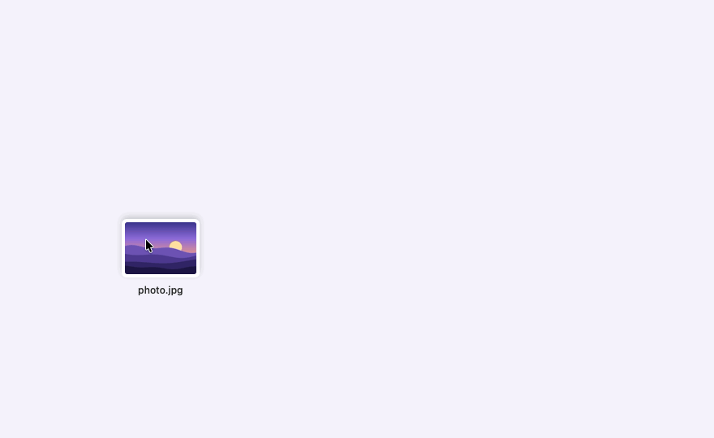
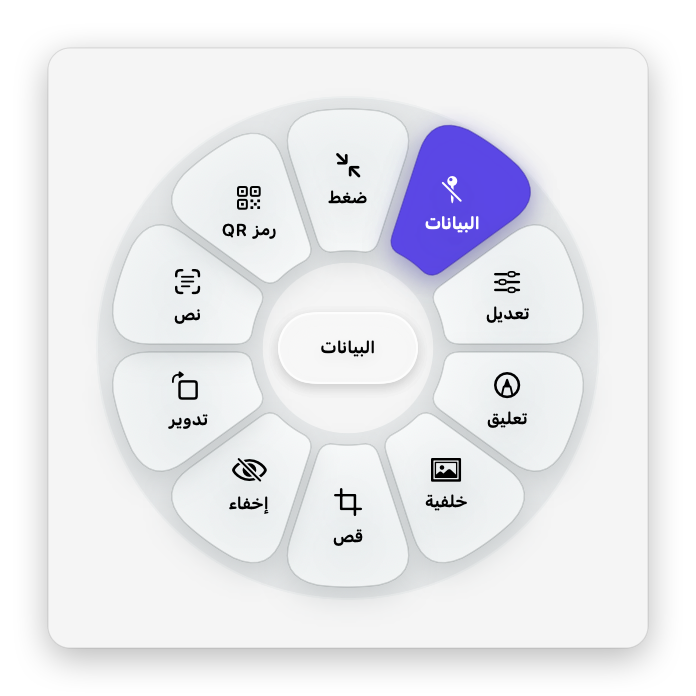
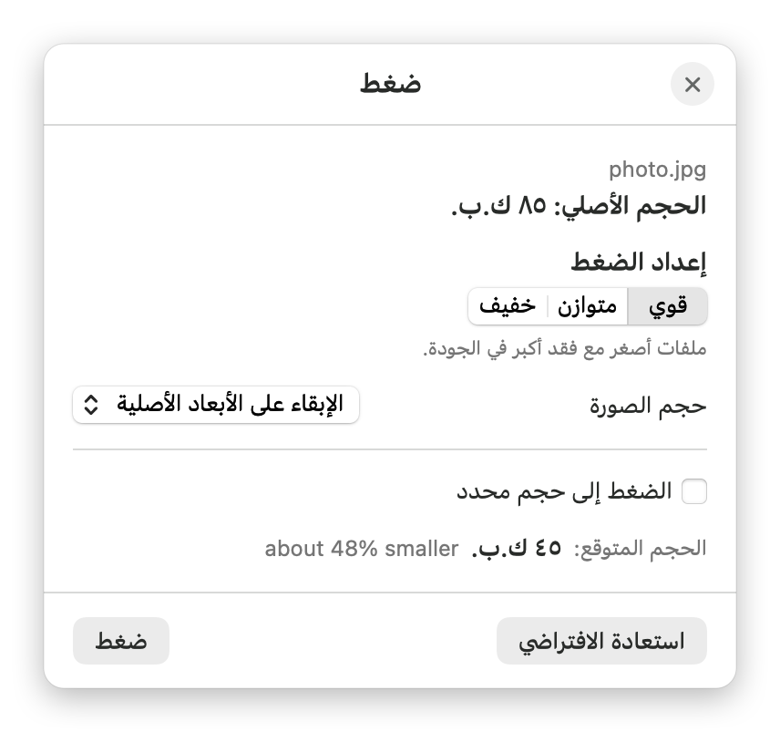
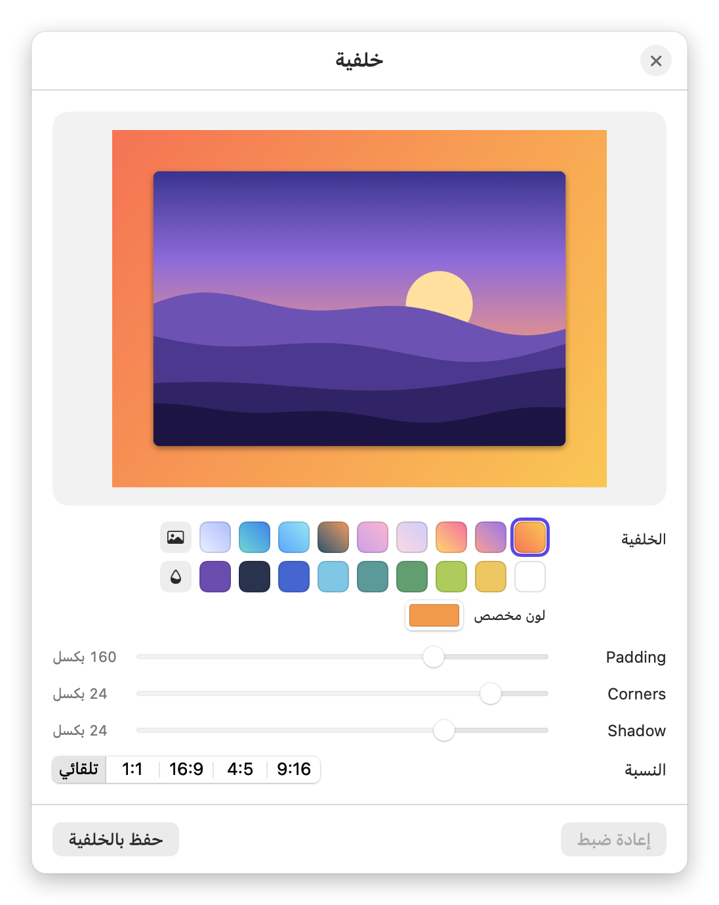
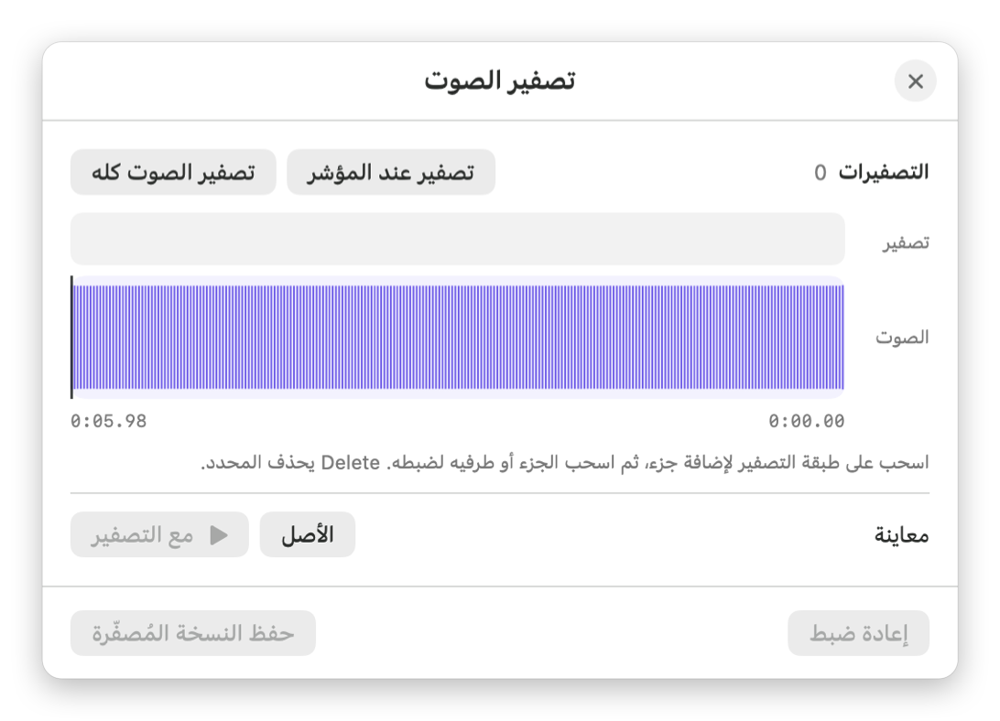
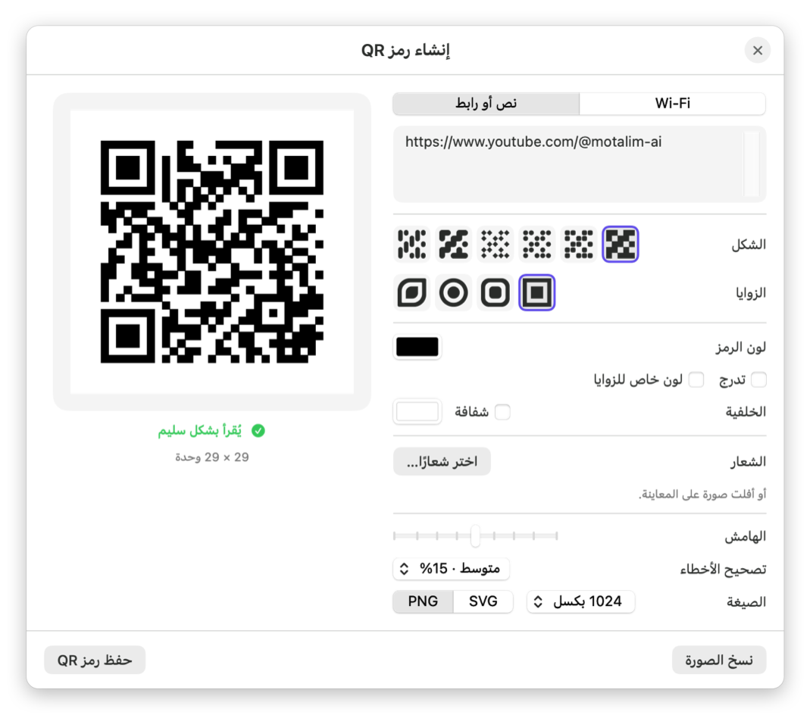
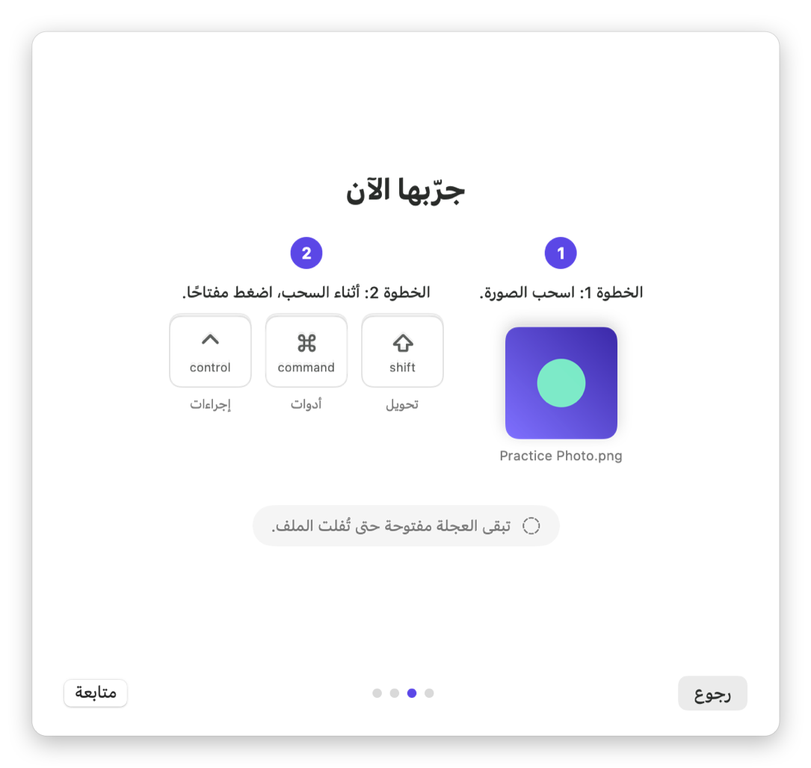

<p align="center">
  <picture>
    <source media="(prefers-color-scheme: dark)" srcset="docs/media/banner-dark.png">
    
  </picture>
</p>

<p align="center">
  <a href="README.md">English</a> · <b>العربية</b>
</p>

<p align="center">
  <a href="https://www.youtube.com/@motalim-ai?sub_confirmation=1"></a>
</p>

<p align="center">
  <a href="https://github.com/motalim-ai/adawat/releases/latest"></a>
  
  <a href="LICENSE"></a>
</p>

---

<div dir="rtl">

**أدوات** تطبيق صغير بيعيش في شريط القوائم على الماك. ابدأ اسحب أي ملف، واضغط مفتاح، فتظهر عجلة اختيارات تحت
الماوس على طول. أفلت الملف على الاختيار اللي عاوزه وخلاص: صيغة جديدة، أو حجم أصغر، أو نسخة معدّلة.
من غير رفع ملفات، ومن غير حساب، ومن غير حد استخدامات. كل حاجة بتحصل على جهازك.

</div>

<p align="center">
  
</p>

<div dir="rtl">

## التثبيت

> **شرح بالفيديو ونصايح وأدوات جديدة:** على [قناة متعلم على يوتيوب](https://www.youtube.com/@motalim-ai?sub_confirmation=1).

1. حمّل **[Adawat.dmg](https://github.com/motalim-ai/adawat/releases/latest/download/Adawat.dmg)** من آخر إصدار.
2. افتحه واسحب **Adawat** لمجلد **Applications**.
3. افتح **Adawat** من Applications. هتظهر رسالة *"Adawat" Not Opened*. اضغط **Done**، ومتضغطش Move to Trash.
4. افتح **إعدادات النظام (System Settings) ← الخصوصية والأمان (Privacy & Security)**، وانزل لتحت لحد جزء
   **Security**، واضغط **Open Anyway** جنب جملة *"Adawat" was blocked to protect your Mac*.
5. اضغط **Open Anyway** تاني، واكتب باسورد الماك. التطبيق هيفتح، ومش هيسألك تاني خالص.
6. هتلاقي أيقونة العجلة في شريط القوائم، ودليل البداية بيخليك تجرّب مرة.

</div>

<details dir="rtl">
<summary>بتحب Terminal؟ أمر واحد بيعمل الخطوات من 3 لـ 5</summary>

```bash
xattr -dr com.apple.quarantine /Applications/Adawat.app && open /Applications/Adawat.app
```

</details>

<div dir="rtl">

**ليه الماك بيسأل؟** لأن أدوات لسه مش موثّق من أبل، فالماك بيسأل مرة واحدة قبل ما يفتح أي برنامج متحمّل من
برا App Store. والتطبيق مفتوح المصدر: تقدر تقرا كل سطر فيه هنا، أو تبنيه بنفسك.
وعلى macOS 14 Sonoma، طريقة **كليك يمين ← Open ← Open** بتشتغل كمان.

محتاج macOS 14 Sonoma أو أحدث على أجهزة Apple silicon.

</div>

<div dir="rtl">

## بيشتغل إزاي؟

1. **اسحب** ملف أو أكتر من Finder أو سطح المكتب أو أي برنامج.
2. **وانت بتسحب، اضغط مفتاح** فتظهر عجلته. العجلة بتفضل مفتوحة لحد ما تفلت الملف.
3. **أفلت** على الاختيار. النتيجة بتتحفظ جنب الملف الأصلي (أو في التنزيلات أو على سطح المكتب حسب اختيارك).

| المفتاح | العجلة | فيها إيه |
| :---: | --- | --- |
| <kbd>⇧ Shift</kbd> | **تحويل** | كل الصيغ اللي الملف ممكن يتحوّل لها |
| <kbd>⌘ Command</kbd> | **أدوات** | ضغط وتعديل وقص وترتيب وغيرهم حسب نوع الملف |
| <kbd>⌃ Control</kbd> | **إجراءات** | AirDrop و Float ونسخ ونقل ونسخ المسار وفتح Terminal |

تقدر تغيّر المفاتيح من الإعدادات. الأدوات اللي محتاجة اختيارات (زي الضغط والقص والتعديل) بتفتح نافذة صغيرة
الأول، والباقي بيشتغل أول ما تفلت الملف.

</div>

<table dir="rtl">
  <tr>
    <td align="center" width="50%"><br><sub>عجلة التحويل لصورة</sub></td>
    <td align="center" width="50%"><br><sub>عجلة الأدوات لصورة</sub></td>
  </tr>
</table>

<div dir="rtl">

## يقدر يعمل إيه؟

### التحويل

| الملف | يتحوّل إلى |
| --- | --- |
| **الصور** (JPEG و PNG و HEIC و WebP و AVIF و TIFF و GIF و BMP و ICO و RAW…) | PNG · JPEG · HEIC · WebP · AVIF · TIFF · GIF · BMP · ICO · PDF، مع الحفاظ على HDR وملفات الألوان |
| **الفيديو** (MP4 و MOV و MKV و WebM و AVI…) | MP4 · MOV · MKV · WebM · GIF · MP3 · M4A، ومن غير إعادة ترميز لما يكون ممكن |
| **الصوت** (MP3 و M4A و WAV و FLAC و AIFF و OGG و Opus…) | MP3 · M4A · WAV · FLAC · AIFF · OGG · Opus |
| **PDF** | Word · Pages · PowerPoint · EPUB · Markdown · نص · PNG · JPEG |
| **المستندات** (Word و Pages و RTF و HTML و Markdown و EPUB و ODT ونص) | PDF · Word · Pages · EPUB · Markdown · RTF · HTML · ODT · نص |
| **الجداول** (Excel و Numbers و ODS و CSV و TSV) | Excel · ODS · CSV · TSV · PDF · HTML |
| **العروض التقديمية** (PowerPoint و Keynote و ODP) | PDF · Keynote · PNG · JPEG |
| **الترجمة** (SRT و VTT) | SRT · VTT · نص |
| **الملفات المضغوطة** (ZIP و TAR و TGZ و GZ و RAR و 7Z…) | ZIP · TAR · TGZ، أو فك الضغط |

### الأدوات

- **الصور:** ضغط (بإعداد جاهز أو حجم محدد أو نسبة) · تعديل (الإضاءة واللون والتفاصيل والمؤثرات) · تعليق
  (أسهم ونص وأشكال وتظليل وأرقام توضيحية وعدسة تكبير) · إضافة خلفية · قص · إخفاء أجزاء (بيكتشف الوجوه
  والنصوص) · تدوير · نسخ النص منها (OCR وبيدعم العربي) · قراءة رمز QR · تعديل أو حذف البيانات ·
  إنشاء PDF · صورة مجمّعة
- **PDF:** ضغط · دمج · ترتيب الصفحات (تحريك وتدوير وتكرار وحذف) · تقسيم · نسخ النص (OCR) · حذف البيانات
- **الفيديو:** ضغط · قص المدة · قص الصورة · تغيير السرعة · حفظ لقطات · تقسيم لمقاطع · إخفاء أجزاء على مدار
  الوقت · دمج · تدوير · كتم الصوت · توحيد مستوى الصوت · حذف البيانات
- **الصوت:** ضغط · قص · قص السكوت · توحيد الصوت (على مرحلتين، معيار EBU R128) · تصفير أجزاء · أحادي أو
  ستيريو · فيديو بموجة الصوت · حذف البيانات
- **رموز QR:** إنشاء رموز لنص أو رابط أو شبكة Wi-Fi، بستة أشكال للنقط وأربعة للزوايا وتدرج ألوان وشعار في
  المنتصف، مع فحص مباشر إن الرمز لسه بيتقري. التصدير PNG أو SVG.

### الـ Float

رف صغير عائم للملفات. أفلت عليه ملفاتك عشان تبقى قريبة منك، واسحبها منه لأي برنامج، أو ألصقه بحافة الشاشة.
وممكن النتائج تفتح فيه تلقائيًا.

</div>

<table dir="rtl">
  <tr>
    <td align="center" width="33%"><br><sub>الضغط</sub></td>
    <td align="center" width="33%"><br><sub>تعديل الصورة</sub></td>
    <td align="center" width="33%"><br><sub>التعليق على الصورة</sub></td>
  </tr>
  <tr>
    <td align="center"><br><sub>إضافة خلفية</sub></td>
    <td align="center"><br><sub>البيانات</sub></td>
    <td align="center"><br><sub>تصفير الصوت</sub></td>
  </tr>
  <tr>
    <td align="center" colspan="2"><br><sub>إنشاء رمز QR</sub></td>
    <td align="center"><br><sub>دليل البداية</sub></td>
  </tr>
</table>

<div dir="rtl">

## عربي وإنجليزي

الواجهة كلها متاحة بالعربي من اليمين للشمال، وبالإنجليزي. أول مرة بيشتغل التطبيق بلغة جهازك، وتقدر تغيّرها
في أي وقت من الإعدادات.

## البناء من الكود

محتاج Xcode 15.3 أو أحدث (أو أدوات سطر الأوامر بتاعته)، ومعاه `cmake` و `pkgconf` عشان نسخة ffmpeg اللي جوه التطبيق.

</div>

```bash
git clone https://github.com/motalim-ai/adawat.git
cd adawat
brew install cmake pkgconf
scripts/build-ffmpeg.sh            # بيبني نسخة ffmpeg الحرة المسموح توزيعها (بياخد كام دقيقة)
scripts/build-app.sh --install     # بيبني التطبيق وينسخه لمجلد Applications
```

<div dir="rtl">

والأمر `scripts/build-app.sh --dmg` بيعمل كمان ملف `build/Adawat-<version>.dmg`. التطبيق مش محتاج Homebrew
عشان يشتغل، لأن ffmpeg و cwebp موجودين جوه التطبيق نفسه.

## الخصوصية

أدوات عمره ما بيبعت ملفاتك لأي مكان. مافيهوش تتبّع ولا حساب ولا أي خاصية إنترنت. وبيكلّم Pages و Keynote
و Numbers (بإذنك) بس لما تحوّل صيغهم.

## الرخصة

أدوات برنامج حر تحت رخصة [GNU General Public License v3.0](LICENSE): تقدر تستخدمه وتدرسه وتشاركه وتعدّل
فيه. ولو وزّعت نسخة معدّلة، لازم تفضل حرة بنفس الرخصة. ونسخ ffmpeg و cwebp اللي جوه التطبيق ليهم رخصهم
الخاصة، تفاصيلها في [THIRD-PARTY-NOTICES.md](THIRD-PARTY-NOTICES.md).

اسم **أدوات** وأيقونته خاصين بالمشروع ده ومش داخلين في الرخصة.

## من صنع متعلم

</div>

<p align="center">
  <a href="https://www.youtube.com/@motalim-ai?sub_confirmation=1"></a>
</p>

<div dir="rtl">

أدوات من صنع **متعلم**. الشروحات والأدوات الجديدة وكواليس الشغل موجودين على
**[قناة متعلم على يوتيوب](https://www.youtube.com/@motalim-ai?sub_confirmation=1)**. اشترك عشان تتابع اللي جاي.
ومن [by-wow.com](https://by-wow.com) كمان.

عندك فكرة أو مشكلة أو ترجمة؟ [افتح Issue](https://github.com/motalim-ai/adawat/issues).

</div>
