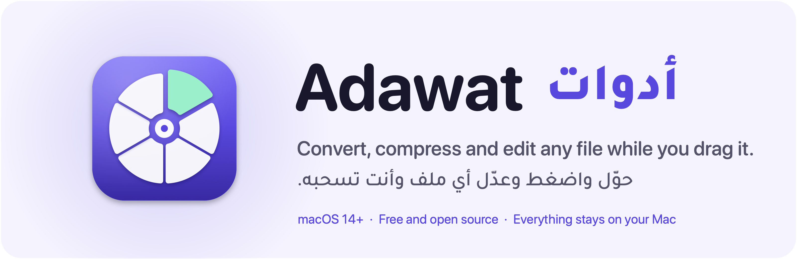
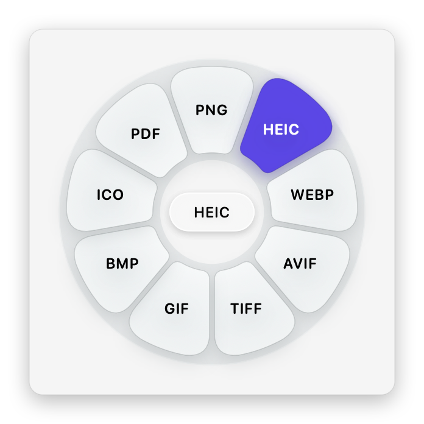
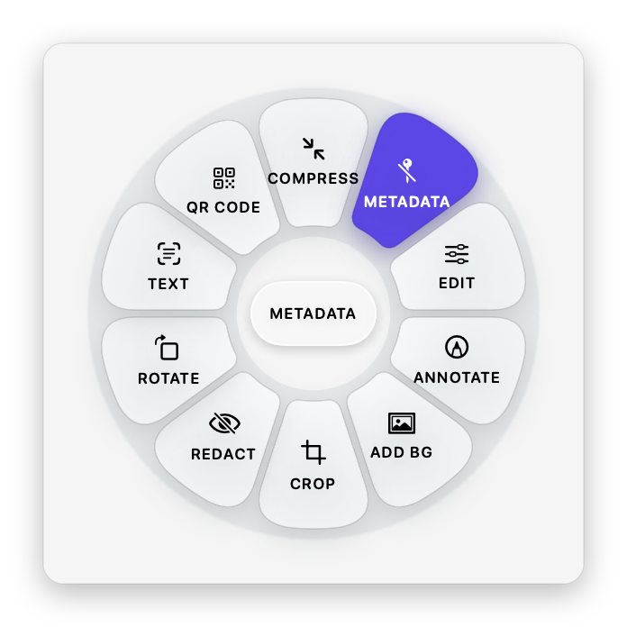
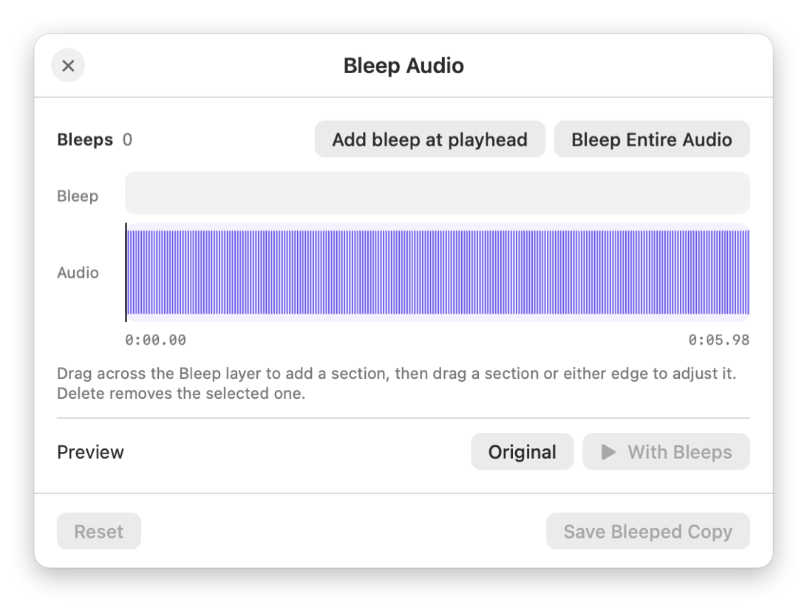
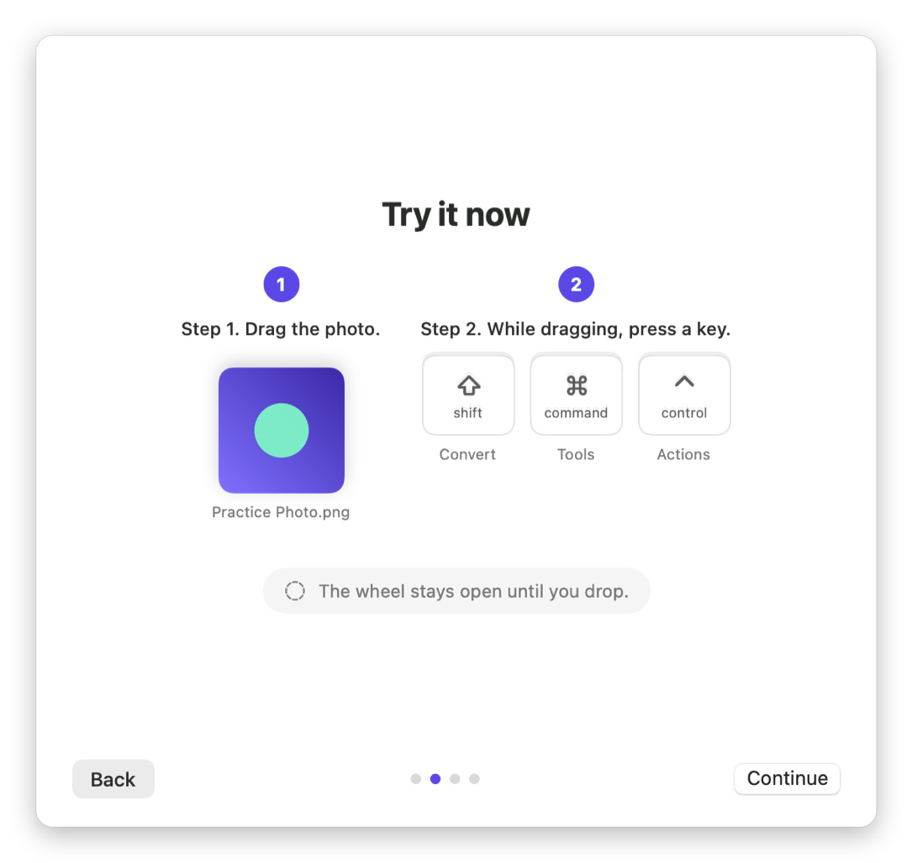

<p align="center">
  <picture>
    <source media="(prefers-color-scheme: dark)" srcset="docs/media/banner-dark.png">
    
  </picture>
</p>

<p align="center">
  <b>English</b> · <a href="README.ar.md">العربية</a>
</p>

<p align="center">
  <a href="https://www.youtube.com/@motalim-ai?sub_confirmation=1"></a>
</p>

<p align="center">
  <a href="https://github.com/motalim-ai/adawat/releases/latest"></a>
  
  
  <a href="LICENSE"></a>
</p>

---

**Adawat** (أدوات, "tools") lives in your Mac's menu bar or next to the Windows clock. Start dragging any file,
press a key, and a wheel of choices opens right under the pointer. Drop the file on a choice and it is done: a new
format, a smaller size, an edited copy. No upload, no account, no limits. Everything happens on your computer.

<p align="center">
  
</p>

## Install

> **Video walkthrough, tips and new tools:** [the Motalim channel on YouTube](https://www.youtube.com/@motalim-ai?sub_confirmation=1).

### Mac

1. Download **[Adawat.dmg](https://github.com/motalim-ai/adawat/releases/latest/download/Adawat.dmg)** from the latest release.
2. Open it and drag **Adawat** into **Applications**.
3. Open **Adawat** from Applications. macOS shows *"Adawat" Not Opened*. Press **Done**, not Move to Trash.
4. Open **System Settings → Privacy & Security**, scroll down to **Security**, and press **Open Anyway** next to
   *"Adawat" was blocked to protect your Mac*.
5. Press **Open Anyway** again and enter your Mac password. Adawat opens, and macOS will not ask again.
6. Look for the wheel icon in the menu bar. The welcome guide lets you practice once.

<details>
<summary>Prefer Terminal? One command does steps 3 to 5</summary>

```bash
xattr -dr com.apple.quarantine /Applications/Adawat.app && open /Applications/Adawat.app
```

</details>

**Why does macOS ask?** Adawat is not notarized by Apple yet, so macOS asks once before opening any app
downloaded outside the App Store. The app is open source: you can read every line here, or build it yourself.
On macOS 14 Sonoma, **right-click → Open → Open** also works.

Requires macOS 14 Sonoma or later on Apple silicon.

### Windows

1. Download the installer for your PC from the latest release:
   - **[Adawat-Setup-x64.exe](https://github.com/motalim-ai/adawat/releases/latest/download/Adawat-Setup-x64.exe)** for most PCs (Intel or AMD).
   - **[Adawat-Setup-arm64.exe](https://github.com/motalim-ai/adawat/releases/latest/download/Adawat-Setup-arm64.exe)** for ARM PCs (Snapdragon, Surface Pro X…).

   Not sure? Open **Settings → System → About** and look at **System type**.
2. Open the installer. If Windows shows *Windows protected your PC*, press **More info**, then **Run anyway**.
   If your browser says the file is not commonly downloaded, choose **Keep**.
3. Pick **العربية** or **English**, then **Next** and **Install**. No administrator password is needed: Adawat
   installs for your account only.
4. Adawat starts next to the clock (look under the **^** arrow if the icon is hidden). The welcome guide lets you
   practice once.

**Why does Windows warn?** The installer is not code-signed yet, so SmartScreen does not know it. The app is open
source, and the SHA-256 of each installer is listed in the release notes.

Requires Windows 10 (version 1809) or Windows 11, 64-bit. Remove it any time from **Settings → Apps**.

<p align="center">
  <br>
  <sub>Adawat on Windows 11: the Tools wheel for a PDF, opened while dragging it from File Explorer</sub>
</p>

## How it works

1. **Drag** one or more files from Finder or File Explorer, the desktop, or any app.
2. **While dragging, press a key** to open its wheel. The wheel stays open until you drop.
3. **Drop** on a choice. The result is saved next to the original (or in Downloads or on the Desktop, as you prefer).

| Mac | Windows | Wheel | What's in it |
| :---: | :---: | --- | --- |
| <kbd>⇧ Shift</kbd> | <kbd>Shift</kbd> | **Convert** | Every format the file can become |
| <kbd>⌘ Command</kbd> | <kbd>Ctrl</kbd> | **Tools** | Compress, edit, crop, trim, organize, and more for that kind of file |
| <kbd>⌃ Control</kbd> | <kbd>Alt</kbd> | **Actions** | Share (AirDrop on Mac), Float, Copy, Move, Copy Path, open in Terminal |

The keys can be changed in Settings. Tools that need choices (Compress, Crop, Edit…) open a small window first;
the rest run as soon as you drop.

<table>
  <tr>
    <td align="center" width="50%"><br><sub>The Convert wheel for a photo</sub></td>
    <td align="center" width="50%"><br><sub>The Tools wheel for a photo</sub></td>
  </tr>
</table>

## What it can do

### Convert

| File | Becomes |
| --- | --- |
| **Images** (JPEG, PNG, HEIC, WebP, AVIF, TIFF, GIF, BMP, ICO, RAW…) | PNG · JPEG · HEIC · WebP · AVIF · TIFF · GIF · BMP · ICO · PDF, keeping HDR and color profiles |
| **Video** (MP4, MOV, MKV, WebM, AVI…) | MP4 · MOV · MKV · WebM · GIF · MP3 · M4A, copying streams without re-encoding when possible |
| **Audio** (MP3, M4A, WAV, FLAC, AIFF, OGG, Opus…) | MP3 · M4A · WAV · FLAC · AIFF · OGG · Opus |
| **PDF** | Word · Pages · PowerPoint · EPUB · Markdown · Text · PNG · JPEG |
| **Documents** (Word, Pages, RTF, HTML, Markdown, EPUB, ODT, Text) | PDF · Word · Pages · EPUB · Markdown · RTF · HTML · ODT · Text |
| **Spreadsheets** (Excel, Numbers, ODS, CSV, TSV) | Excel · ODS · CSV · TSV · PDF · HTML |
| **Presentations** (PowerPoint, Keynote, ODP) | PDF · Keynote · PNG · JPEG |
| **Subtitles** (SRT, VTT) | SRT · VTT · Text |
| **Archives** (ZIP, TAR, TGZ, GZ, RAR, 7Z…) | ZIP · TAR · TGZ, or extract |

On Windows the list is the same, with these differences: PDF also becomes **Excel**; HEIC opens but is not offered
as an output; Pages, Keynote and Numbers are Mac-only; and presentations need PowerPoint or LibreOffice installed.

### Tools

- **Photos:** Compress (to a preset, a target size, or a percentage) · Edit (light, color, detail, effects) ·
  Annotate (arrows, text, shapes, highlights, numbered callouts, magnifier) · Add Background · Crop · Redact
  (detects faces and text) · Rotate · Copy Text (OCR, Arabic included) · Read QR Code · Edit or remove metadata ·
  Create PDF · Create Collage
- **PDF:** Compress · Merge · Organize pages (reorder, rotate, duplicate, delete) · Split · Copy Text (OCR) ·
  Remove metadata
- **Video:** Compress · Trim · Crop · Change speed · Save frames · Split into clips · Redact areas over time ·
  Join · Rotate · Mute · Normalize volume · Remove metadata
- **Audio:** Compress · Trim · Trim silence · Normalize loudness (two-pass, EBU R128) · Bleep sections ·
  Mono / stereo channels · Audio visualizer video · Remove metadata
- **QR codes:** create codes for text, links and Wi-Fi, with six dot shapes, four corner styles, gradients, a
  logo in the middle, and a live check that the code still scans. Exports PNG or SVG.

### Float

A small floating shelf for files. Drop files on it to keep them at hand, drag them out to any app, or attach it
to the edge of the screen. Results can open in a Float automatically.

<table>
  <tr>
    <td align="center" width="33%"><br><sub>Compress</sub></td>
    <td align="center" width="33%"><br><sub>Edit Photo</sub></td>
    <td align="center" width="33%"><br><sub>Annotate</sub></td>
  </tr>
  <tr>
    <td align="center"><br><sub>Add Background</sub></td>
    <td align="center"><br><sub>Metadata</sub></td>
    <td align="center"><br><sub>Bleep Audio</sub></td>
  </tr>
  <tr>
    <td align="center" colspan="2"><br><sub>Create QR Code</sub></td>
    <td align="center"><br><sub>The welcome guide</sub></td>
  </tr>
</table>

## Arabic and English

The whole interface is available in Arabic, right to left, and in English, on Mac and Windows. Adawat follows
your system's language on first launch (on Windows, the language you pick in the installer), and you can switch
at any time in Settings.

## Build from source

You need Xcode 15.3 or later (or its command line tools), plus `cmake` and `pkgconf` for the bundled ffmpeg.

```bash
git clone https://github.com/motalim-ai/adawat.git
cd adawat
brew install cmake pkgconf
scripts/build-ffmpeg.sh            # builds the free, redistributable ffmpeg into build/ffmpeg (takes a few minutes)
scripts/build-app.sh --install     # builds build/Adawat.app and copies it to /Applications
```

`scripts/build-app.sh --dmg` also makes `build/Adawat-<version>.dmg`. The app runs without Homebrew: ffmpeg and
cwebp travel inside the app bundle.

### Windows

The Windows app is in `windows/`, written in C# with .NET 10 and WPF. It builds on Windows, or on a Mac with the
.NET 10 SDK.

```bash
windows/tools/fetch-ffmpeg.sh                                   # the pinned GPL ffmpeg for x64 and ARM64
dotnet build windows/src/Adawat.App/Adawat.App.csproj -c Release
windows/tools/build-installer.sh                                # Adawat-Setup-x64.exe and Adawat-Setup-arm64.exe
```

`build-installer.sh` publishes both versions and compiles `windows/installer/Adawat.iss` with
[Inno Setup 6](https://jrsoftware.org/isinfo.php) on a Windows machine it reaches over SSH (`ADAWAT_WIN_HOST`).
`adawat-cli` runs any wheel choice from the command line, for testing: `adawat-cli list photo.jpg`,
`adawat-cli run image.webp photo.jpg`.

<details>
<summary>Project layout</summary>

| Path | What's there |
| --- | --- |
| `Sources/Adawat/App` | Menu bar, settings, welcome guide, command-line test modes |
| `Sources/Adawat/Wheel` | Drag watching and the radial wheel |
| `Sources/Adawat/Operations` | Every conversion and tool: images, media, PDF, documents, sheets, slides, archives, QR |
| `Sources/Adawat/Windows` | The option windows for tools |
| `Sources/Adawat/Float` | The Float shelf |
| `Resources` | App icon and translations (`ar.lproj`) |
| `scripts` | Build, ffmpeg, icon, banner, translation and screenshot scripts |
| `windows/src/Adawat.Core` | Windows: every conversion and tool, shared by the app and `adawat-cli` |
| `windows/src/Adawat.App` | Windows: tray icon, drag watching, the wheel, Floats and the option windows |
| `windows/src/Adawat.Cli` | Windows: the `adawat-cli` command line |
| `windows/installer`, `windows/tools` | Windows: the Inno Setup script, ffmpeg and installer scripts |
| `windows/shared` | Arabic translations for Windows, generated from `scripts/arabic.py` with the Mac's |

</details>

## Privacy

Adawat never sends your files anywhere, on Mac or Windows. It has no analytics, no account and no network
features. On Mac, Pages, Keynote and Numbers are asked (with your permission) only when you convert their formats.

## License

Adawat is free software under the [GNU General Public License v3.0](LICENSE): you can use it, study it, share it
and change it. If you distribute a modified version, it has to stay free under the same license.
The bundled ffmpeg, cwebp and Windows libraries keep their own licenses; see
[THIRD-PARTY-NOTICES.md](THIRD-PARTY-NOTICES.md).

The name **Adawat** and its icon identify this project and are not covered by the license.

## Made by Motalim

<p align="center">
  <a href="https://www.youtube.com/@motalim-ai?sub_confirmation=1"></a>
</p>

Adawat is made by **Motalim**. Tutorials, new tools and behind-the-scenes videos are on
**[the Motalim YouTube channel](https://www.youtube.com/@motalim-ai?sub_confirmation=1)**. Subscribe to follow
what comes next. Also by [by-wow.com](https://by-wow.com).

Ideas, bugs or translations? [Open an issue](https://github.com/motalim-ai/adawat/issues).
