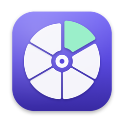

<p align="center">
  
</p>

<h1 align="center">Adawat · أدوات</h1>

<p align="center">
  <b>English</b> · <a href="README.ar.md">العربية</a>
</p>

<p align="center">
  <a href="https://www.youtube.com/@motalim-ai?sub_confirmation=1"></a>
</p>

<p align="center">
  <a href="https://github.com/motalim-ai/adawat/releases/latest"></a>
  
  <a href="LICENSE"></a>
</p>

---

**Adawat** (أدوات, "tools") lives next to the Windows clock. Start dragging any file, press a key, and a
wheel of choices opens right under the pointer. Drop the file on a choice and it is done: a new format, a
smaller size, an edited copy. No upload, no account, no limits. Everything happens on your PC.

## Install

> **Video walkthrough, tips and new tools:** [the Motalim channel on YouTube](https://www.youtube.com/@motalim-ai?sub_confirmation=1).

1. Download the installer for your PC from the latest release:
   - **[Adawat-Setup-x64.exe](https://github.com/motalim-ai/adawat/releases/latest/download/Adawat-Setup-x64.exe)** for most PCs (Intel or AMD).
   - **[Adawat-Setup-arm64.exe](https://github.com/motalim-ai/adawat/releases/latest/download/Adawat-Setup-arm64.exe)** for ARM PCs (Snapdragon, Surface Pro X…).

   Not sure? Open **Settings → System → About** and look at **System type**.
2. Open the installer. If Windows shows *Windows protected your PC*, press **More info**, then **Run anyway**.
   If your browser says the file is not commonly downloaded, choose **Keep**.
3. Pick **العربية** or **English**, then **Next** and **Install**. No administrator password is needed: Adawat
   installs for your account only.
4. Adawat starts next to the clock (look under the **^** arrow if the icon is hidden). The welcome guide lets you
   practice once.

**Why does Windows warn?** The installer is not code-signed yet, so SmartScreen does not know it. The app is open
source, and the SHA-256 of each installer is listed in the release notes.

Requires Windows 10 (version 1809) or Windows 11, 64-bit. Remove it any time from **Settings → Apps**.

## How it works

1. **Drag** one or more files from File Explorer, the desktop, or any app.
2. **While dragging, press a key** to open its wheel. The wheel stays open until you drop.
3. **Drop** on a choice. The result is saved next to the original (or in Downloads or on the Desktop, as you prefer).

| Key | Wheel | What's in it |
| :---: | --- | --- |
| <kbd>Shift</kbd> | **Convert** | Every format the file can become |
| <kbd>Ctrl</kbd> | **Tools** | Compress, edit, crop, trim, organize, and more for that kind of file |
| <kbd>Alt</kbd> | **Actions** | Share, Float, Copy, Move, Copy Path, open in Terminal |

The keys can be changed in Settings. Tools that need choices (Compress, Crop, Edit…) open a small window first;
the rest run as soon as you drop.

## What it can do

### Convert

| File | Becomes |
| --- | --- |
| **Images** (JPEG, PNG, HEIC, WebP, AVIF, TIFF, GIF, BMP, ICO, RAW…) | PNG · JPEG · WebP · AVIF · TIFF · GIF · BMP · ICO · PDF, keeping HDR and color profiles |
| **Video** (MP4, MOV, MKV, WebM, AVI…) | MP4 · MOV · MKV · WebM · GIF · MP3 · M4A, copying streams without re-encoding when possible |
| **Audio** (MP3, M4A, WAV, FLAC, AIFF, OGG, Opus…) | MP3 · M4A · WAV · FLAC · AIFF · OGG · Opus |
| **PDF** | Word · Excel · PowerPoint · EPUB · Markdown · Text · PNG · JPEG |
| **Documents** (Word, RTF, HTML, Markdown, EPUB, ODT, Text) | PDF · Word · EPUB · Markdown · RTF · HTML · ODT · Text |
| **Spreadsheets** (Excel, ODS, CSV, TSV) | Excel · ODS · CSV · TSV · PDF · HTML |
| **Presentations** (PowerPoint, ODP) | PDF · PNG · JPEG |
| **Subtitles** (SRT, VTT) | SRT · VTT · Text |
| **Archives** (ZIP, TAR, TGZ, GZ, RAR, 7Z…) | ZIP · TAR · TGZ, or extract |

HEIC files open but are not offered as an output. Presentations need PowerPoint or LibreOffice installed.

### Tools

- **Photos:** Compress (to a preset, a target size, or a percentage) · Edit (light, color, detail, effects) ·
  Annotate (arrows, text, shapes, highlights, numbered callouts, magnifier) · Add Background · Crop · Redact
  (detects faces and text) · Rotate · Copy Text (OCR, Arabic included) · Read QR Code · Edit or remove metadata ·
  Create PDF · Create Collage
- **PDF:** Compress · Merge · Organize pages (reorder, rotate, duplicate, delete) · Split · Copy Text (OCR) ·
  Remove metadata
- **Video:** Compress · Trim · Crop · Change speed · Save frames · Split into clips · Redact areas over time ·
  Join · Rotate · Mute · Normalize volume · Remove metadata
- **Audio:** Compress · Trim · Trim silence · Normalize loudness (two-pass, EBU R128) · Bleep sections ·
  Mono / stereo channels · Audio visualizer video · Remove metadata
- **QR codes:** create codes for text, links and Wi-Fi, with six dot shapes, four corner styles, gradients, a
  logo in the middle, and a live check that the code still scans. Exports PNG or SVG.

### Quick tools

Screenshot, scan QR from the screen, copy text from the screen, clipboard history, notepad, quick launcher,
fix keyboard layout, Bluetooth sending, and more from the quick wheel (<kbd>Ctrl</kbd>+<kbd>Space</kbd>).

### Float

A small floating shelf for files. Drop files on it to keep them at hand, drag them out to any app, or attach it
to the edge of the screen. Results can open in a Float automatically.

## Arabic and English

The whole interface is available in Arabic, right to left, and in English. Adawat follows your system's
language on first launch (the language you pick in the installer), and you can switch at any time in Settings.

## Build from source

You need Windows 10 1809 or later, the [.NET 10 SDK](https://dotnet.microsoft.com/download), and
[Inno Setup 6](https://jrsoftware.org/isinfo.php) only if you want to build the installer. The project builds on
Windows only. Everything is PowerShell; the commands below run from the repository root.

```powershell
windows/tools/fetch-ffmpeg.ps1                                  # the pinned GPL ffmpeg for x64 and ARM64
dotnet build windows/src/Adawat.App/Adawat.App.csproj -c Release
windows/tools/build-installer.ps1                               # Adawat-Setup-x64.exe and Adawat-Setup-arm64.exe
```

`fetch-ffmpeg.ps1` downloads the same pinned FFmpeg build for `win-x64` and `win-arm64` into
`windows/build/ffmpeg`. `build-installer.ps1` publishes both versions, copies ffmpeg next to the app, and
compiles `windows/installer/Adawat.iss`; pass `-InnoSetup <path to ISCC.exe>` if Inno Setup is in a custom
location. `adawat-cli` runs any wheel choice from the command line, for testing:
`adawat-cli list photo.jpg`, `adawat-cli run image.webp photo.jpg`, `adawat-cli doctor`.

<details>
<summary>Project layout</summary>

| Path | What's there |
| --- | --- |
| `windows/src/Adawat.Core` | Every conversion and tool, shared by the app and `adawat-cli` |
| `windows/src/Adawat.App` | Tray icon, drag watching, the wheel, Floats and the option windows |
| `windows/src/Adawat.Cli` | The `adawat-cli` command line |
| `windows/src/Adawat.Core/Platform` | Windows-specific helpers: OCR, PDF printing, clipboard, RTF, QR drawing |
| `windows/shared` | Arabic translations for the interface |
| `windows/installer`, `windows/tools` | The Inno Setup script, ffmpeg and installer scripts |
| `windows/assets` | App icon |

</details>

## Privacy

Adawat never sends your files anywhere. It has no analytics, no account and no network features.

## License

Adawat is free software under the [GNU General Public License v3.0](LICENSE): you can use it, study it, share it
and change it. If you distribute a modified version, it has to stay free under the same license.
The bundled ffmpeg and the .NET libraries keep their own licenses; see
[THIRD-PARTY-NOTICES.md](THIRD-PARTY-NOTICES.md).

The name **Adawat** and its icon identify this project and are not covered by the license.

## Made by Motalim

<p align="center">
  <a href="https://www.youtube.com/@motalim-ai?sub_confirmation=1"></a>
</p>

Adawat is made by **Motalim**. Tutorials, new tools and behind-the-scenes videos are on
**[the Motalim YouTube channel](https://www.youtube.com/@motalim-ai?sub_confirmation=1)**. Subscribe to follow
what comes next. Also by [by-wow.com](https://by-wow.com).

Ideas, bugs or translations? [Open an issue](https://github.com/motalim-ai/adawat/issues).
